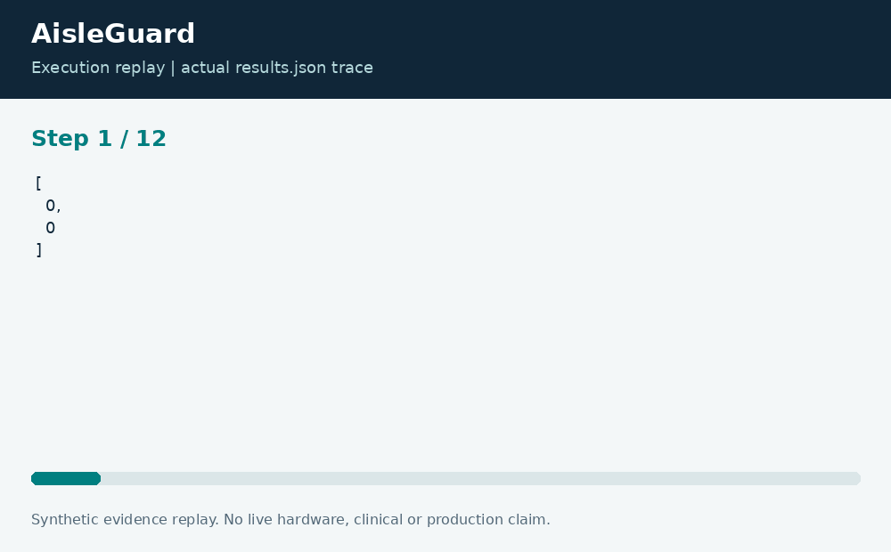

# AisleGuard: Robot Route Replanning

**Neco Thomas · Project Phoenix · Independent portfolio prototype**  
Implementation and editorial preparation assisted by AI. All inputs are synthetic. Results below come from the included local execution; they are not employment accomplishments or production outcomes.

## The decision worth solving

Map changes are an operations problem, not just a pathfinding problem. A blocked aisle can turn a previously valid route into a stale instruction. A useful planning prototype must show the new route and distinguish an unreachable destination from a successful short path.

**Engineering question:** How can a simulated warehouse robot find a short route after an aisle closes?

## What I am sharing

AisleGuard models a small warehouse as a four-neighbor occupancy grid. The native C++ planner uses a Manhattan heuristic, stores predecessor cells, and reconstructs a route. Python validates the fixture and invokes the compiled program. A second planning pass applies explicit closure cells before computing a fresh route.


The project is self-contained: source, its own fixture, eight tests, a saved result, a technical diagram, a result chart, and an animated execution trace. It has no runtime dependency on the other nineteen projects. The common entry point is only a convenience for reviewers; the decision logic belongs to this project.

## Run the demonstration

Requirements: Python 3.12 or newer and g++ with C++17 support. The primary CLI uses only the Python standard library; native components require the named toolchain. No API keys, paid services, patient records, robot hardware, or cloud account are required.

```bash
python3 app.py
python3 -m unittest discover -s tests -v
```

On Windows use `python` or `py -3` if `python3` is not installed. Native C/C++ entry points currently expect the Linux GCC toolchain. Linux execution is verified; other operating systems are extension targets until separately tested. `run.ps1` and `run.sh` are convenience launchers, not evidence of OS certification.

## What the run actually showed

The demonstration reaches the destination in 11 steps both before and after the closure. Equal route length does not mean equal route: the trace avoids the newly blocked cells. Tests check adjacency, blocked endpoints, unreachable goals, malformed grids, and a known four-step route.

| Metric | Fixture result |
| --- | ---: |
| initial steps | 11 |
| replanned steps | 11 |


The chart uses one stated measurement unit and is computed directly from the saved output. Exact values and the execution trace are in [results.json](results.json), and individual assertions are visible in [the test file](tests/test_project.py).



## The tradeoff and the boundary

A* is appropriate for this discrete, uniform-cost grid. It does not model turning radius, localization uncertainty, moving people, or braking distance. Replanning starts from the fixture origin; it does not pretend to recover a physical robot pose in motion.

The test evidence supports behavior on the published cases. It does not establish production reliability or a universal performance estimate. Invalid inputs are rejected or represented explicitly according to the implementation; a reviewer should read the tested boundary cases before extending the input contract.

## How a team would move this forward

A robotics engineer would own map semantics and motion constraints. An operations lead would own closure reporting. A safety engineer would separately review any connection to hardware. The next milestone is a replay suite with adversarial maps and a comparison against an independent breadth-first reference over generated grids.

For a principal-level review, the useful handoff is the decision contract: who supplies each input, who interprets exceptions, who approves any real-world action, and what evidence would justify expanding the scope. That handoff is separate from the prototype run and remains a proposed next step.

## Reproduce and review

Each folder can be copied out and run independently. `validation.log` records the eight local assertions. Optional chart regeneration uses Pillow: install `requirements-visuals.txt`, then run `python3 visualize.py`. The figures replay saved results and do not fabricate measurements. Re-run the CLI before redrawing figures after changing a fixture.

Primary technical reference: [https://docs.nav2.org/](https://docs.nav2.org/). This reference informs the implementation context; it does not endorse or certify this project.

[Source and project files](https://github.com/bigneek78/data-platform-reliability-lab/tree/main/frontier-projects/01-aisleguard) · [All twenty projects](https://github.com/bigneek78/data-platform-reliability-lab/tree/main/frontier-projects)
