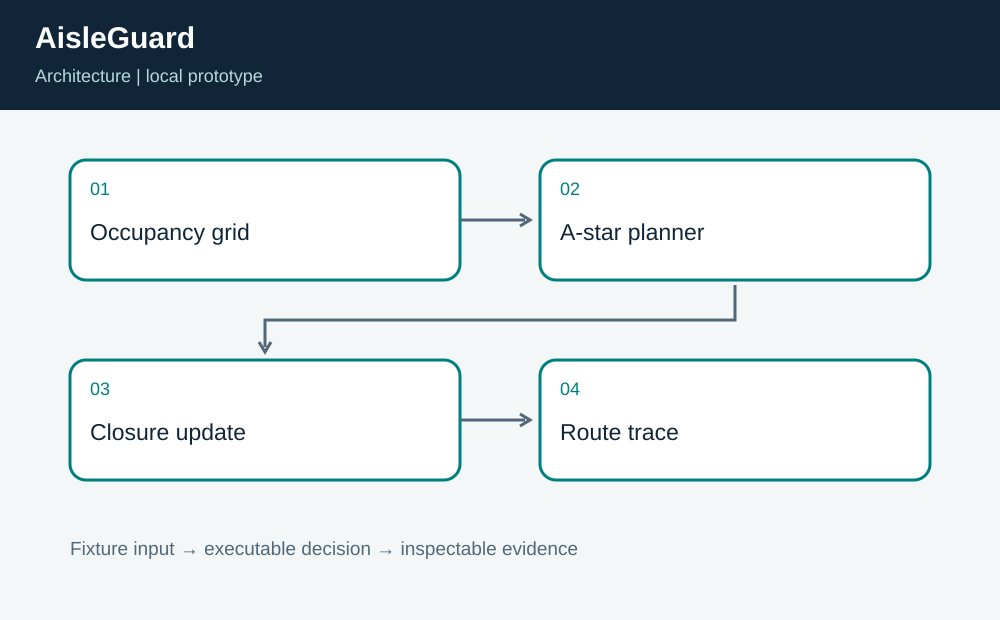
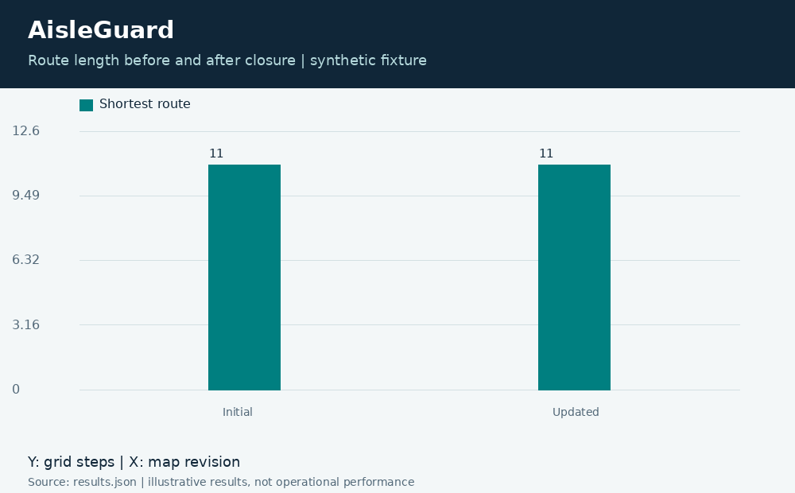

# AisleGuard: Robot Route Replanning

**Independent project 01 of 20 · Robotics · C++17 + Python**

Prepared for Neco Thomas with AI assistance. Synthetic portfolio prototype; no production, clinical, physical-hardware, or employer-delivery claim.

How can a simulated warehouse robot find a short route after an aisle closes?

**Method:** Manhattan-heuristic A* with a second plan after a map update.

**Observed result:** The demonstration reaches the destination in 11 steps both before and after the closure. Equal route length does not mean equal route: the trace avoids the newly blocked cells. Tests check adjacency, blocked endpoints, unreachable goals, malformed grids, and a known four-step route.



## Run this project on its own

Requirements: Python 3.12 or newer and g++ with C++17 support. No other project folder is imported.

```bash
python3 app.py
python3 -m unittest discover -s tests -v
```

**Local validation: 8 tests passed.** The CLI and all required native components executed on Linux. See [validation.log](validation.log) and [results.json](results.json). Optional figures need Pillow; application/tests otherwise use standard-library Python plus the named native toolchain.

| Metric | Result |
| --- | ---: |
| initial steps | 11 |
| replanned steps | 11 |



## Engineering boundary

A* is appropriate for this discrete, uniform-cost grid. It does not model turning radius, localization uncertainty, moving people, or braking distance. Replanning starts from the fixture origin; it does not pretend to recover a physical robot pose in motion.

## Team handoff

A robotics engineer would own map semantics and motion constraints. An operations lead would own closure reporting. A safety engineer would separately review any connection to hardware. The next milestone is a replay suite with adversarial maps and a comparison against an independent breadth-first reference over generated grids.

Read the [complete article](ARTICLE.md), inspect the [tests](tests/test_project.py), or view the [animated result trace](assets/replay.gif). The [manifest](project.json) identifies this standalone project. Configurations for CI and containers are supplied as configurations; their status is tracked separately from local execution.

Primary reference: https://docs.nav2.org/
