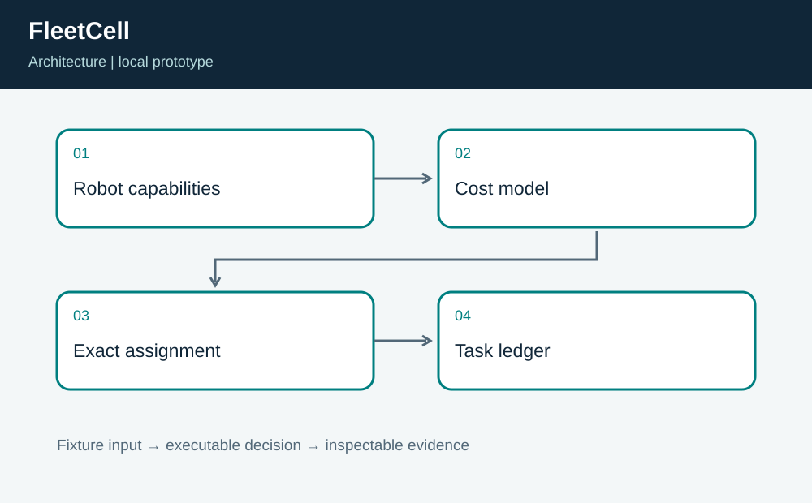
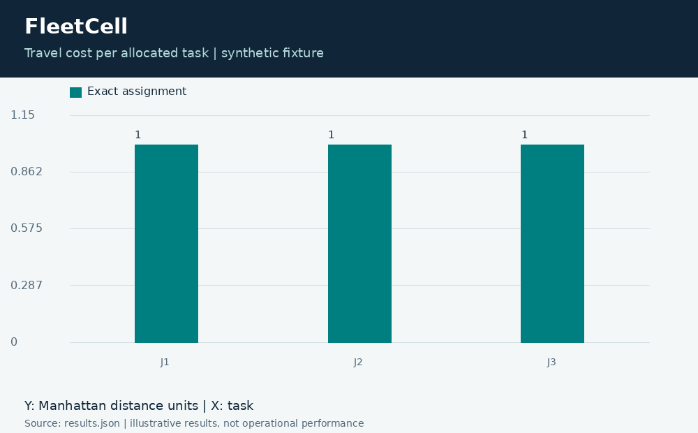
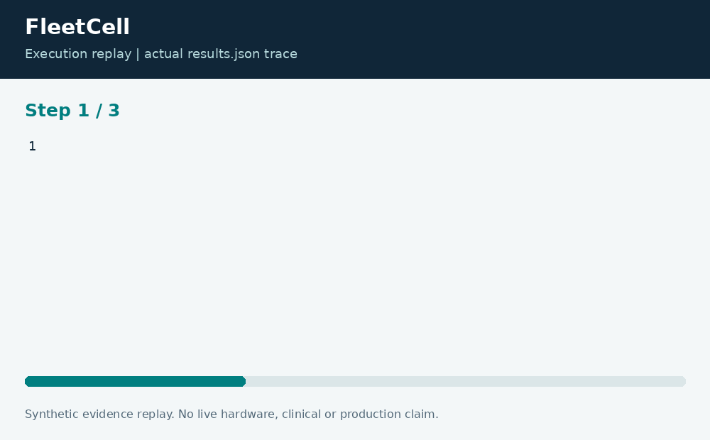

# FleetCell: Capability-Aware Robot Assignment

**Neco Thomas · Project Phoenix · Independent portfolio prototype**  
Implementation and editorial preparation assisted by AI. All inputs are synthetic. Results below come from the included local execution; they are not employment accomplishments or production outcomes.

## The decision worth solving

A fast assignment can leave a specialized task stranded. When the nearest robot is also the only robot with a required capability, choosing it for a general task can consume a scarce resource. The planning question is about the complete workload, not the first convenient match.

**Engineering question:** Which robot should take each task when capabilities and travel costs conflict?

## What I am sharing

FleetCell assigns each task to one eligible robot. Travel cost is Manhattan distance on a fictional work floor; capability lists determine eligibility. A cached subset dynamic program evaluates complete assignments and chooses the minimum total distance. The output preserves the robot, job, and distance for each decision.



The project is self-contained: source, its own fixture, eight tests, a saved result, a technical diagram, a result chart, and an animated execution trace. It has no runtime dependency on the other nineteen projects. The common entry point is only a convenience for reviewers; the decision logic belongs to this project.

## Run the demonstration

Requirements: Python 3.12 or newer. The primary CLI uses only the Python standard library; native components require the named toolchain. No API keys, paid services, patient records, robot hardware, or cloud account are required.

```bash
python3 app.py
python3 -m unittest discover -s tests -v
```

On Windows use `python` or `py -3` if `python3` is not installed. Native C/C++ entry points currently expect the Linux GCC toolchain. Linux execution is verified; other operating systems are extension targets until separately tested. `run.ps1` and `run.sh` are convenience launchers, not evidence of OS certification.

## What the run actually showed

The optimal complete allocation costs 3 distance units. The fixture-order greedy comparator cannot complete this workload, so its result is explicitly null rather than an invented numeric improvement. A permutation-based test independently checks the optimum for the demonstration.

| Metric | Fixture result |
| --- | ---: |
| optimal distance | 3 |
| greedy distance | None |



The chart uses one stated measurement unit and is computed directly from the saved output. Exact values and the execution trace are in [results.json](results.json), and individual assertions are visible in [the test file](tests/test_project.py).



## The tradeoff and the boundary

The exact method is deliberately small, with at most 16 robots. It is not a continuous fleet dispatcher and does not model battery charge, collision avoidance, task durations, or a robot taking several sequential jobs. Those omissions define the next engineering questions.

The test evidence supports behavior on the published cases. It does not establish production reliability or a universal performance estimate. Invalid inputs are rejected or represented explicitly according to the implementation; a reviewer should read the tested boundary cases before extending the input contract.

## How a team would move this forward

The operations team should define mandatory capabilities; robotics engineers should supply validated travel estimates; a planning owner should approve how workload priorities are represented. Before a larger pilot, benchmark a scalable solver against the exact small-case oracle and add execution-time and failure-reassignment constraints.

For a principal-level review, the useful handoff is the decision contract: who supplies each input, who interprets exceptions, who approves any real-world action, and what evidence would justify expanding the scope. That handoff is separate from the prototype run and remains a proposed next step.

## Reproduce and review

Each folder can be copied out and run independently. `validation.log` records the eight local assertions. Optional chart regeneration uses Pillow: install `requirements-visuals.txt`, then run `python3 visualize.py`. The figures replay saved results and do not fabricate measurements. Re-run the CLI before redrawing figures after changing a fixture.

Primary technical reference: [https://docs.python.org/3/library/functools.html](https://docs.python.org/3/library/functools.html). This reference informs the implementation context; it does not endorse or certify this project.

[Source and project files](https://github.com/bigneek78/data-platform-reliability-lab/tree/main/frontier-projects/02-fleetcell) · [All twenty projects](https://github.com/bigneek78/data-platform-reliability-lab/tree/main/frontier-projects)
