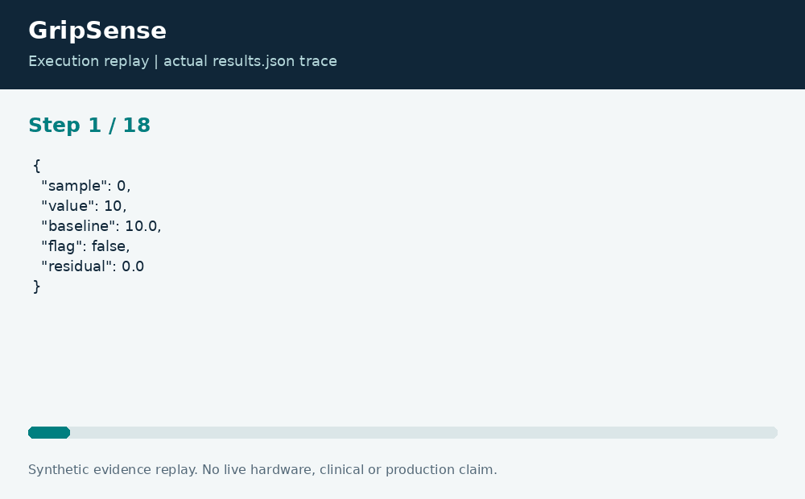

# GripSense: Motor Telemetry Change Detection

**Neco Thomas · Project Phoenix · Independent portfolio prototype**  
Implementation and editorial preparation assisted by AI. All inputs are synthetic. Results below come from the included local execution; they are not employment accomplishments or production outcomes.

## The decision worth solving

A slowly adapting detector can accidentally absorb a developing fault into its definition of normal. A telemetry review tool therefore needs to show how its baseline changes and when it stops updating. Otherwise, an attractive chart can hide the mechanism that caused a missed alert.

**Engineering question:** Can an inexpensive detector flag a sustained change without learning the fault as normal?

## What I am sharing

GripSense calibrates an initial mean, then evaluates each new sample against an exponentially weighted baseline. If a residual exceeds the configured threshold, it marks the sample and freezes the baseline update for that sample. The threshold is in the fixture measurement units, not an estimated probability of failure.


The project is self-contained: source, its own fixture, eight tests, a saved result, a technical diagram, a result chart, and an animated execution trace. It has no runtime dependency on the other nineteen projects. The common entry point is only a convenience for reviewers; the decision logic belongs to this project.

## Run the demonstration

Requirements: Python 3.12 or newer. The primary CLI uses only the Python standard library; native components require the named toolchain. No API keys, paid services, patient records, robot hardware, or cloud account are required.

```bash
python3 app.py
python3 -m unittest discover -s tests -v
```

On Windows use `python` or `py -3` if `python3` is not installed. Native C/C++ entry points currently expect the Linux GCC toolchain. Linux execution is verified; other operating systems are extension targets until separately tested. `run.ps1` and `run.sh` are convenience launchers, not evidence of OS certification.

## What the run actually showed

Four injected high readings are flagged, exactly at samples 12 through 15. The baseline stays fixed across that sequence, and the following ordinary readings return to an unflagged state. The published trace includes the raw value, residual, baseline, and flag at every index.

| Metric | Fixture result |
| --- | ---: |
| flagged samples | 4 |
| reviewed samples | 10 |


The chart uses one stated measurement unit and is computed directly from the saved output. Exact values and the execution trace are in [results.json](results.json), and individual assertions are visible in [the test file](tests/test_project.py).



## The tradeoff and the boundary

This detector is a review aid for synthetic motor telemetry. It has no learned equipment-specific fault model and cannot establish root cause. A threshold that works on this fixture may miss gradual drift or generate false alerts on a different operating regime.

The test evidence supports behavior on the published cases. It does not establish production reliability or a universal performance estimate. Invalid inputs are rejected or represented explicitly according to the implementation; a reviewer should read the tested boundary cases before extending the input contract.

## How a team would move this forward

A controls engineer should define operating modes and sensor units. Reliability staff should label confirmed events. The next milestone is a blinded, independently labeled replay set with precision, recall, detection delay, and false-alert burden, followed by separate hardware testing if the model remains useful.

For a principal-level review, the useful handoff is the decision contract: who supplies each input, who interprets exceptions, who approves any real-world action, and what evidence would justify expanding the scope. That handoff is separate from the prototype run and remains a proposed next step.

## Reproduce and review

Each folder can be copied out and run independently. `validation.log` records the eight local assertions. Optional chart regeneration uses Pillow: install `requirements-visuals.txt`, then run `python3 visualize.py`. The figures replay saved results and do not fabricate measurements. Re-run the CLI before redrawing figures after changing a fixture.

Primary technical reference: [https://docs.python.org/3/library/statistics.html](https://docs.python.org/3/library/statistics.html). This reference informs the implementation context; it does not endorse or certify this project.

[Source and project files](https://github.com/bigneek78/data-platform-reliability-lab/tree/main/frontier-projects/03-gripsense) · [All twenty projects](https://github.com/bigneek78/data-platform-reliability-lab/tree/main/frontier-projects)
