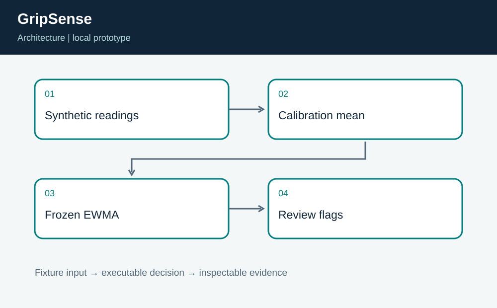
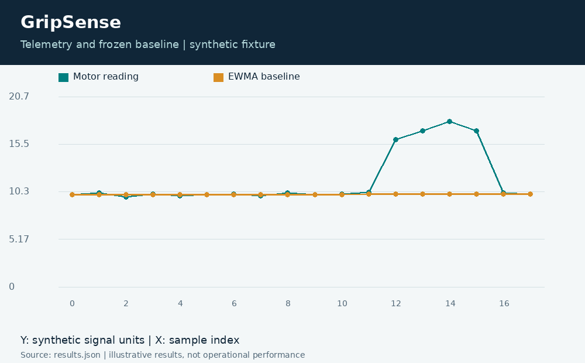

# GripSense: Motor Telemetry Change Detection

**Independent project 03 of 20 · Robotics · Python**

Prepared for Neco Thomas with AI assistance. Synthetic portfolio prototype; no production, clinical, physical-hardware, or employer-delivery claim.

Can an inexpensive detector flag a sustained change without learning the fault as normal?

**Method:** EWMA residual detector with a calibration window and frozen baseline on flagged readings.

**Observed result:** Four injected high readings are flagged, exactly at samples 12 through 15. The baseline stays fixed across that sequence, and the following ordinary readings return to an unflagged state. The published trace includes the raw value, residual, baseline, and flag at every index.



## Run this project on its own

Requirements: Python 3.12 or newer. No other project folder is imported.

```bash
python3 app.py
python3 -m unittest discover -s tests -v
```

**Local validation: 8 tests passed.** The CLI and all required native components executed on Linux. See [validation.log](validation.log) and [results.json](results.json). Optional figures need Pillow; application/tests otherwise use standard-library Python plus the named native toolchain.

| Metric | Result |
| --- | ---: |
| flagged samples | 4 |
| reviewed samples | 10 |



## Engineering boundary

This detector is a review aid for synthetic motor telemetry. It has no learned equipment-specific fault model and cannot establish root cause. A threshold that works on this fixture may miss gradual drift or generate false alerts on a different operating regime.

## Team handoff

A controls engineer should define operating modes and sensor units. Reliability staff should label confirmed events. The next milestone is a blinded, independently labeled replay set with precision, recall, detection delay, and false-alert burden, followed by separate hardware testing if the model remains useful.

Read the [complete article](ARTICLE.md), inspect the [tests](tests/test_project.py), or view the [animated result trace](assets/replay.gif). The [manifest](project.json) identifies this standalone project. Configurations for CI and containers are supplied as configurations; their status is tracked separately from local execution.

Primary reference: https://docs.python.org/3/library/statistics.html
