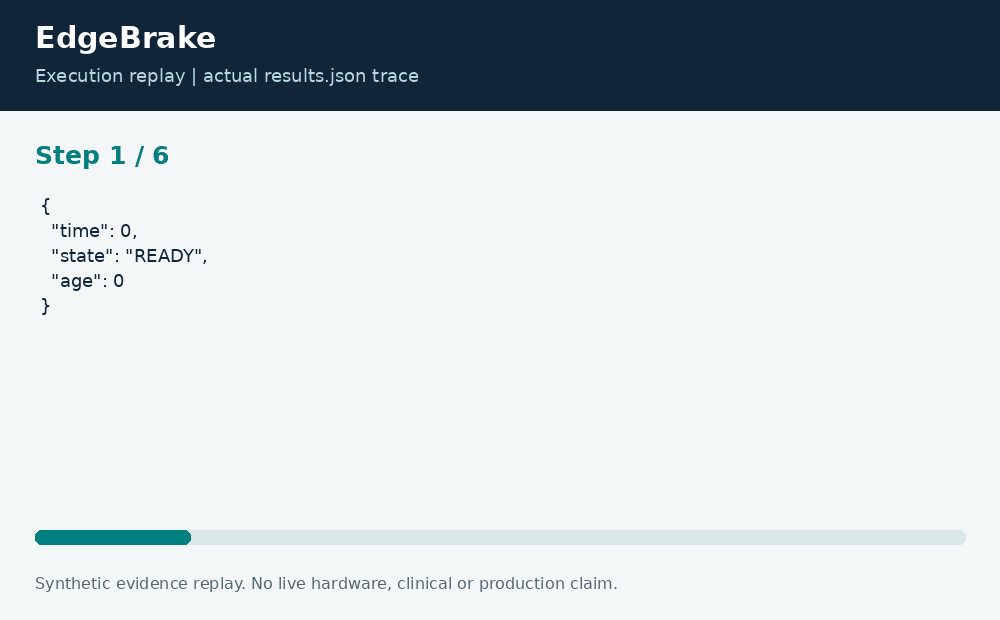

# EdgeBrake: Latched Robot Watchdog Simulation

**Neco Thomas · Project Phoenix · Independent portfolio prototype**  
Implementation and editorial preparation assisted by AI. All inputs are synthetic. Results below come from the included local execution; they are not employment accomplishments or production outcomes.

## The decision worth solving

A healthy reading after a communication gap should not silently erase a stop condition. Recovery behavior matters as much as the trigger. This project makes that behavior inspectable through a small host-side state machine rather than hiding it behind an animation.

**Engineering question:** When should a host-side simulator latch a stop after stale telemetry or an emergency-stop event?

## What I am sharing

EdgeBrake evaluates telemetry age and an emergency-stop flag for each ordered event. A stale reading or stop input latches STOP. A healthy event without a reset leaves the stop latched. Only an explicit reset on a healthy event returns the simulation to READY. The state machine is implemented in C11 and driven through a validated Python fixture.


The project is self-contained: source, its own fixture, eight tests, a saved result, a technical diagram, a result chart, and an animated execution trace. It has no runtime dependency on the other nineteen projects. The common entry point is only a convenience for reviewers; the decision logic belongs to this project.

## Run the demonstration

Requirements: Python 3.12 or newer and GCC with C11 support. The primary CLI uses only the Python standard library; native components require the named toolchain. No API keys, paid services, patient records, robot hardware, or cloud account are required.

```bash
python3 app.py
python3 -m unittest discover -s tests -v
```

On Windows use `python` or `py -3` if `python3` is not installed. Native C/C++ entry points currently expect the Linux GCC toolchain. Linux execution is verified; other operating systems are extension targets until separately tested. `run.ps1` and `run.sh` are convenience launchers, not evidence of OS certification.

## What the run actually showed

The six-event demonstration produces READY, READY, STOP, STOP, STOP, READY. It records three stopped and three ready events. Boundary tests cover exact age equality, stale resets, healthy resets, time reversal, invalid controls, and an empty stream.

| Metric | Fixture result |
| --- | ---: |
| stopped events | 3 |
| ready events | 3 |


The chart uses one stated measurement unit and is computed directly from the saved output. Exact values and the execution trace are in [results.json](results.json), and individual assertions are visible in [the test file](tests/test_project.py).



## The tradeoff and the boundary

This is a host simulation, not a safety-rated controller. Event timestamps and sensor ages are supplied by the fixture rather than a trusted monotonic clock. No actuator, emergency circuit, real-time scheduler, or physical stopping-distance measurement is connected.

The test evidence supports behavior on the published cases. It does not establish production reliability or a universal performance estimate. Invalid inputs are rejected or represented explicitly according to the implementation; a reviewer should read the tested boundary cases before extending the input contract.

## How a team would move this forward

Controls, firmware, operations, and safety reviewers would need distinct sign-off responsibilities before hardware integration. A next iteration should define restart authority, watchdog independence, clock-failure behavior, and requirements traceability. The code demonstrates state semantics; hardware assurance requires evidence outside this repository.

For a principal-level review, the useful handoff is the decision contract: who supplies each input, who interprets exceptions, who approves any real-world action, and what evidence would justify expanding the scope. That handoff is separate from the prototype run and remains a proposed next step.

## Reproduce and review

Each folder can be copied out and run independently. `validation.log` records the eight local assertions. Optional chart regeneration uses Pillow: install `requirements-visuals.txt`, then run `python3 visualize.py`. The figures replay saved results and do not fabricate measurements. Re-run the CLI before redrawing figures after changing a fixture.

Primary technical reference: [https://www.open-std.org/jtc1/sc22/wg14/](https://www.open-std.org/jtc1/sc22/wg14/). This reference informs the implementation context; it does not endorse or certify this project.

[Source and project files](https://github.com/bigneek78/data-platform-reliability-lab/tree/main/frontier-projects/04-edgebrake) · [All twenty projects](https://github.com/bigneek78/data-platform-reliability-lab/tree/main/frontier-projects)
