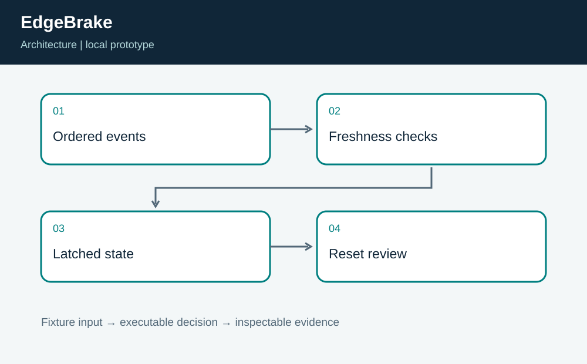
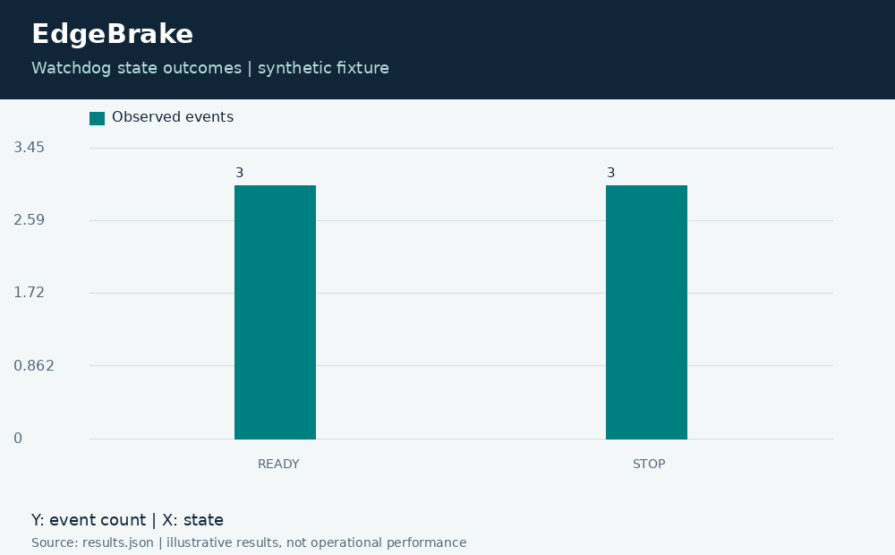

# EdgeBrake: Latched Robot Watchdog Simulation

**Independent project 04 of 20 · Robotics · C11 + Python**

Prepared for Neco Thomas with AI assistance. Synthetic portfolio prototype; no production, clinical, physical-hardware, or employer-delivery claim.

When should a host-side simulator latch a stop after stale telemetry or an emergency-stop event?

**Method:** Deterministic state machine with freshness checks and explicit healthy reset.

**Observed result:** The six-event demonstration produces READY, READY, STOP, STOP, STOP, READY. It records three stopped and three ready events. Boundary tests cover exact age equality, stale resets, healthy resets, time reversal, invalid controls, and an empty stream.



## Run this project on its own

Requirements: Python 3.12 or newer and GCC with C11 support. No other project folder is imported.

```bash
python3 app.py
python3 -m unittest discover -s tests -v
```

**Local validation: 8 tests passed.** The CLI and all required native components executed on Linux. See [validation.log](validation.log) and [results.json](results.json). Optional figures need Pillow; application/tests otherwise use standard-library Python plus the named native toolchain.

| Metric | Result |
| --- | ---: |
| stopped events | 3 |
| ready events | 3 |



## Engineering boundary

This is a host simulation, not a safety-rated controller. Event timestamps and sensor ages are supplied by the fixture rather than a trusted monotonic clock. No actuator, emergency circuit, real-time scheduler, or physical stopping-distance measurement is connected.

## Team handoff

Controls, firmware, operations, and safety reviewers would need distinct sign-off responsibilities before hardware integration. A next iteration should define restart authority, watchdog independence, clock-failure behavior, and requirements traceability. The code demonstrates state semantics; hardware assurance requires evidence outside this repository.

Read the [complete article](ARTICLE.md), inspect the [tests](tests/test_project.py), or view the [animated result trace](assets/replay.gif). The [manifest](project.json) identifies this standalone project. Configurations for CI and containers are supplied as configurations; their status is tracked separately from local execution.

Primary reference: https://www.open-std.org/jtc1/sc22/wg14/
