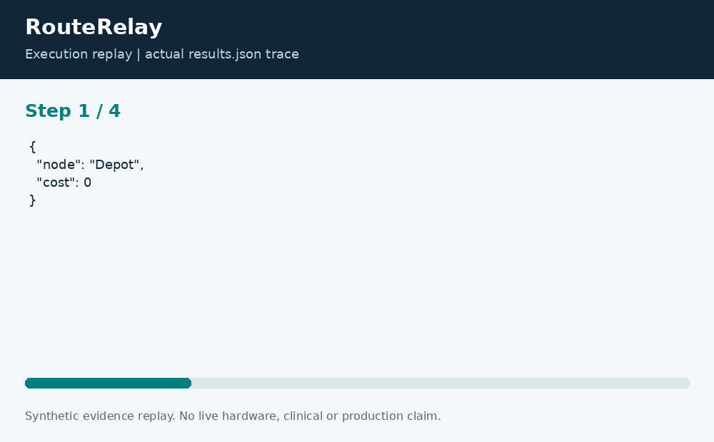

# RouteRelay: Road Closure Routing

**Neco Thomas · Project Phoenix · Independent portfolio prototype**  
Implementation and editorial preparation assisted by AI. All inputs are synthetic. Results below come from the included local execution; they are not employment accomplishments or production outcomes.

## The decision worth solving

A closure-aware route recommendation should explain which roads it excluded and what route remains. Using an old shortest path after a network change creates a different problem from finding a route in the original graph. RouteRelay treats closures as first-class fixture inputs.

**Engineering question:** Which route remains available when a road segment closes?

## What I am sharing

A JavaScript command-line program runs Dijkstra over a directed weighted graph. A Python entry point validates edge identities, nonnegative costs, endpoints, and closure references. The result contains the route, cost, and settled-node trace. An unreachable destination is represented with a null cost and an empty path.


The project is self-contained: source, its own fixture, eight tests, a saved result, a technical diagram, a result chart, and an animated execution trace. It has no runtime dependency on the other nineteen projects. The common entry point is only a convenience for reviewers; the decision logic belongs to this project.

## Run the demonstration

Requirements: Python 3.12 or newer and Node.js 24 or newer. The primary CLI uses only the Python standard library; native components require the named toolchain. No API keys, paid services, patient records, robot hardware, or cloud account are required.

```bash
python3 app.py
python3 -m unittest discover -s tests -v
```

On Windows use `python` or `py -3` if `python3` is not installed. Native C/C++ entry points currently expect the Linux GCC toolchain. Linux execution is verified; other operating systems are extension targets until separately tested. `run.ps1` and `run.sh` are convenience launchers, not evidence of OS certification.

## What the run actually showed

The open synthetic road network has a cost-6 route. Closing edge e4 changes the chosen route to Depot, A, Clinic at cost 7. Tests also verify a disconnected depot, the zero-cost same-node case, and rejection of negative edge weights or unknown closures.

| Metric | Fixture result |
| --- | ---: |
| route cost | 7 |
| edges used | 2 |


The chart uses one stated measurement unit and is computed directly from the saved output. Exact values and the execution trace are in [results.json](results.json), and individual assertions are visible in [the test file](tests/test_project.py).



## The tradeoff and the boundary

The model uses static additive cost units, not live traffic or guaranteed arrival times. It does not account for turn restrictions, truck clearances, weather, or emergency priorities. Directed edges are intentional: reversing an edge requires separate source data.

The test evidence supports behavior on the published cases. It does not establish production reliability or a universal performance estimate. Invalid inputs are rejected or represented explicitly according to the implementation; a reviewer should read the tested boundary cases before extending the input contract.

## How a team would move this forward

A transportation analyst should define the meaning and freshness of cost. Data engineering should validate closure identifiers, while operations should own an explanation of exceptions. The next milestone is a versioned graph replay with incident timestamps and independent route checks before connecting any external road feed.

For a principal-level review, the useful handoff is the decision contract: who supplies each input, who interprets exceptions, who approves any real-world action, and what evidence would justify expanding the scope. That handoff is separate from the prototype run and remains a proposed next step.

## Reproduce and review

Each folder can be copied out and run independently. `validation.log` records the eight local assertions. Optional chart regeneration uses Pillow: install `requirements-visuals.txt`, then run `python3 visualize.py`. The figures replay saved results and do not fabricate measurements. Re-run the CLI before redrawing figures after changing a fixture.

Primary technical reference: [https://nodejs.org/api/](https://nodejs.org/api/). This reference informs the implementation context; it does not endorse or certify this project.

[Source and project files](https://github.com/bigneek78/data-platform-reliability-lab/tree/main/frontier-projects/05-routerelay) · [All twenty projects](https://github.com/bigneek78/data-platform-reliability-lab/tree/main/frontier-projects)
