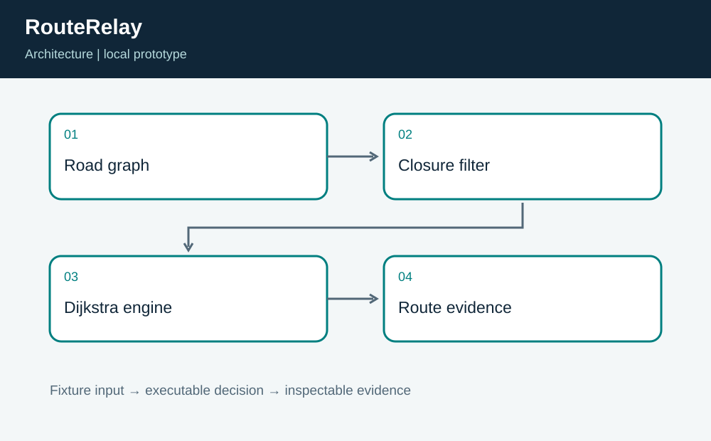
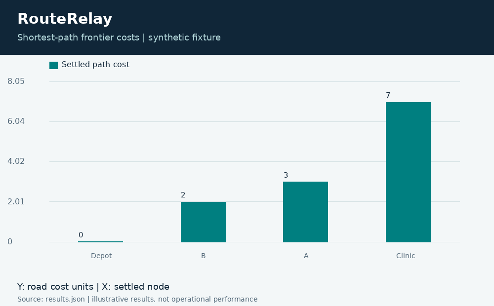

# RouteRelay: Road Closure Routing

**Independent project 05 of 20 · Transportation · JavaScript + Python**

Prepared for Neco Thomas with AI assistance. Synthetic portfolio prototype; no production, clinical, physical-hardware, or employer-delivery claim.

Which route remains available when a road segment closes?

**Method:** Dijkstra shortest paths on a directed graph with excluded edge identifiers.

**Observed result:** The open synthetic road network has a cost-6 route. Closing edge e4 changes the chosen route to Depot, A, Clinic at cost 7. Tests also verify a disconnected depot, the zero-cost same-node case, and rejection of negative edge weights or unknown closures.



## Run this project on its own

Requirements: Python 3.12 or newer and Node.js 24 or newer. No other project folder is imported.

```bash
python3 app.py
python3 -m unittest discover -s tests -v
```

**Local validation: 8 tests passed.** The CLI and all required native components executed on Linux. See [validation.log](validation.log) and [results.json](results.json). Optional figures need Pillow; application/tests otherwise use standard-library Python plus the named native toolchain.

| Metric | Result |
| --- | ---: |
| route cost | 7 |
| edges used | 2 |



## Engineering boundary

The model uses static additive cost units, not live traffic or guaranteed arrival times. It does not account for turn restrictions, truck clearances, weather, or emergency priorities. Directed edges are intentional: reversing an edge requires separate source data.

## Team handoff

A transportation analyst should define the meaning and freshness of cost. Data engineering should validate closure identifiers, while operations should own an explanation of exceptions. The next milestone is a versioned graph replay with incident timestamps and independent route checks before connecting any external road feed.

Read the [complete article](ARTICLE.md), inspect the [tests](tests/test_project.py), or view the [animated result trace](assets/replay.gif). The [manifest](project.json) identifies this standalone project. Configurations for CI and containers are supplied as configurations; their status is tracked separately from local execution.

Primary reference: https://nodejs.org/api/
