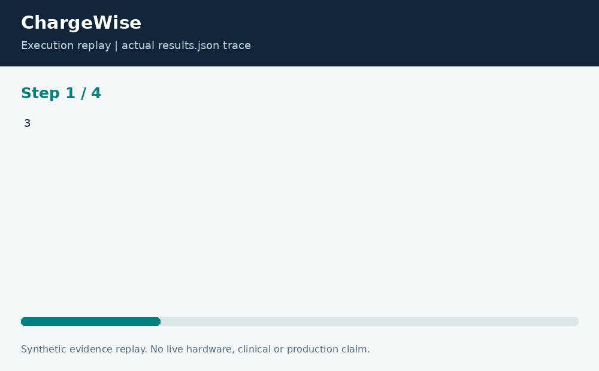

# ChargeWise: Deadline-Aware EV Charging

**Neco Thomas · Project Phoenix · Independent portfolio prototype**  
Implementation and editorial preparation assisted by AI. All inputs are synthetic. Results below come from the included local execution; they are not employment accomplishments or production outcomes.

## The decision worth solving

A charging site must balance individual departure needs against a shared electrical limit. Simply choosing the cheapest hour can starve an early departure, while filling vehicles in input order can waste constrained capacity. The scheduling objective must state which commitment takes precedence.

**Engineering question:** How can a shared charging site deliver energy before departure while favoring lower-cost hours?

## What I am sharing

ChargeWise first maximizes delivered energy within each vehicle arrival, departure, and hourly-rate window. Among maximum-flow solutions it minimizes the fixture energy cost. The integral residual network connects vehicles to eligible hourly slots and enforces a shared site capacity. Reverse edges allow earlier assignments to be reconsidered.


The project is self-contained: source, its own fixture, eight tests, a saved result, a technical diagram, a result chart, and an animated execution trace. It has no runtime dependency on the other nineteen projects. The common entry point is only a convenience for reviewers; the decision logic belongs to this project.

## Run the demonstration

Requirements: Python 3.12 or newer. The primary CLI uses only the Python standard library; native components require the named toolchain. No API keys, paid services, patient records, robot hardware, or cloud account are required.

```bash
python3 app.py
python3 -m unittest discover -s tests -v
```

On Windows use `python` or `py -3` if `python3` is not installed. Native C/C++ entry points currently expect the Linux GCC toolchain. Linux execution is verified; other operating systems are extension targets until separately tested. `run.ps1` and `run.sh` are convenience launchers, not evidence of OS certification.

## What the run actually showed

The demonstration delivers all 9 requested kWh at a cost of 39 fixture units, with no unmet vehicle demand. Tests verify conservation, per-hour capacity, vehicle availability, rate bounds, an infeasible zero-capacity case, and a counterexample that requires residual reassignment.

| Metric | Fixture result |
| --- | ---: |
| delivered kwh | 9 |
| unmet kwh | 0 |
| cost units | 39 |


The chart uses one stated measurement unit and is computed directly from the saved output. Exact values and the execution trace are in [results.json](results.json), and individual assertions are visible in [the test file](tests/test_project.py).



## The tradeoff and the boundary

Each slot is one hour and energy is quantized to whole kWh. Prices are synthetic cost units. The prototype excludes conversion losses, demand charges, battery health, charger failures, and electrical protection. It produces a plan, not charger commands.

The test evidence supports behavior on the published cases. It does not establish production reliability or a universal performance estimate. Invalid inputs are rejected or represented explicitly according to the implementation; a reviewer should read the tested boundary cases before extending the input contract.

## How a team would move this forward

Facilities engineers should own site limits; fleet operations should validate departure commitments; finance should define tariffs; software engineers should own infeasibility reporting. Before operational use, add real metering reconciliation, fractional energy, uncertainty buffers, and a bounded response when vehicles arrive late.

For a principal-level review, the useful handoff is the decision contract: who supplies each input, who interprets exceptions, who approves any real-world action, and what evidence would justify expanding the scope. That handoff is separate from the prototype run and remains a proposed next step.

## Reproduce and review

Each folder can be copied out and run independently. `validation.log` records the eight local assertions. Optional chart regeneration uses Pillow: install `requirements-visuals.txt`, then run `python3 visualize.py`. The figures replay saved results and do not fabricate measurements. Re-run the CLI before redrawing figures after changing a fixture.

Primary technical reference: [https://docs.python.org/3/library/unittest.html](https://docs.python.org/3/library/unittest.html). This reference informs the implementation context; it does not endorse or certify this project.

[Source and project files](https://github.com/bigneek78/data-platform-reliability-lab/tree/main/frontier-projects/06-chargewise) · [All twenty projects](https://github.com/bigneek78/data-platform-reliability-lab/tree/main/frontier-projects)
