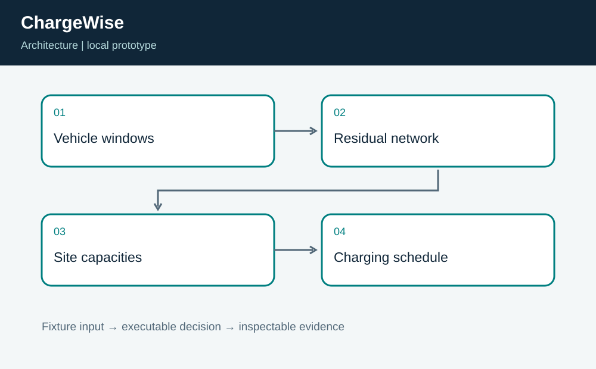
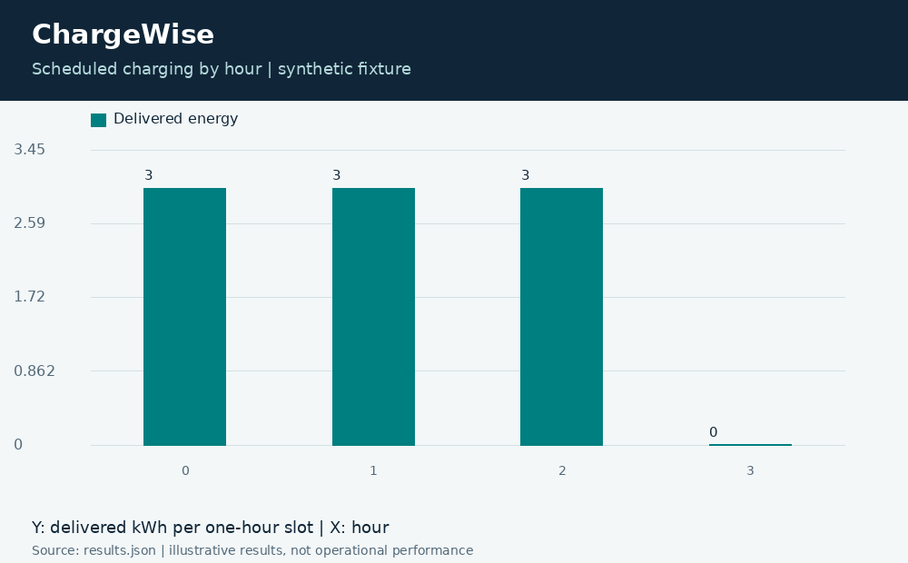

# ChargeWise: Deadline-Aware EV Charging

**Independent project 06 of 20 · Transportation and energy · Python**

Prepared for Neco Thomas with AI assistance. Synthetic portfolio prototype; no production, clinical, physical-hardware, or employer-delivery claim.

How can a shared charging site deliver energy before departure while favoring lower-cost hours?

**Method:** Integral minimum-cost maximum flow with vehicle, hourly-rate, and site-capacity constraints.

**Observed result:** The demonstration delivers all 9 requested kWh at a cost of 39 fixture units, with no unmet vehicle demand. Tests verify conservation, per-hour capacity, vehicle availability, rate bounds, an infeasible zero-capacity case, and a counterexample that requires residual reassignment.



## Run this project on its own

Requirements: Python 3.12 or newer. No other project folder is imported.

```bash
python3 app.py
python3 -m unittest discover -s tests -v
```

**Local validation: 8 tests passed.** The CLI and all required native components executed on Linux. See [validation.log](validation.log) and [results.json](results.json). Optional figures need Pillow; application/tests otherwise use standard-library Python plus the named native toolchain.

| Metric | Result |
| --- | ---: |
| delivered kwh | 9 |
| unmet kwh | 0 |
| cost units | 39 |



## Engineering boundary

Each slot is one hour and energy is quantized to whole kWh. Prices are synthetic cost units. The prototype excludes conversion losses, demand charges, battery health, charger failures, and electrical protection. It produces a plan, not charger commands.

## Team handoff

Facilities engineers should own site limits; fleet operations should validate departure commitments; finance should define tariffs; software engineers should own infeasibility reporting. Before operational use, add real metering reconciliation, fractional energy, uncertainty buffers, and a bounded response when vehicles arrive late.

Read the [complete article](ARTICLE.md), inspect the [tests](tests/test_project.py), or view the [animated result trace](assets/replay.gif). The [manifest](project.json) identifies this standalone project. Configurations for CI and containers are supplied as configurations; their status is tracked separately from local execution.

Primary reference: https://docs.python.org/3/library/unittest.html
