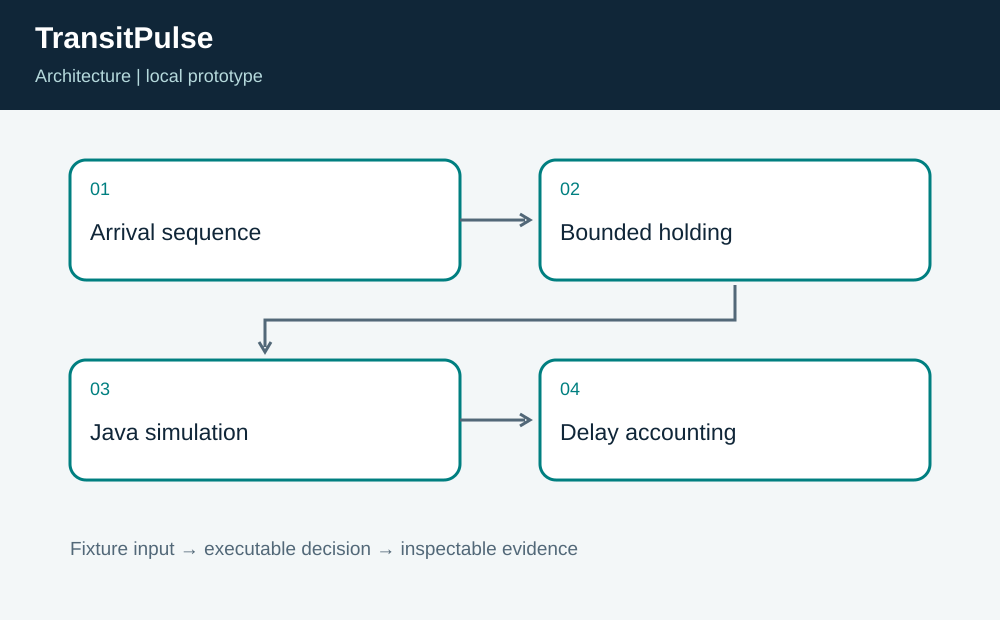
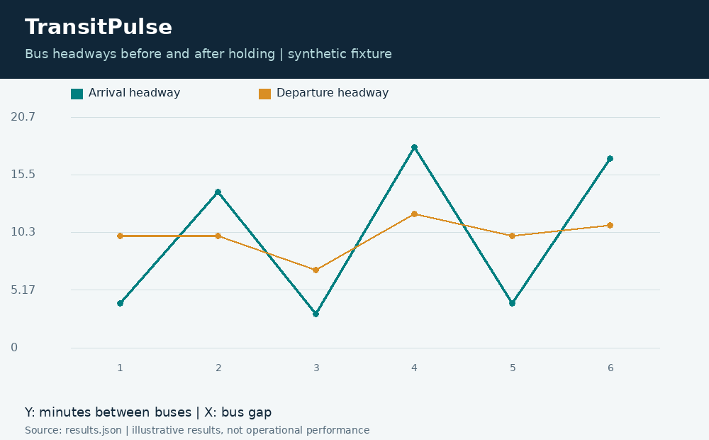
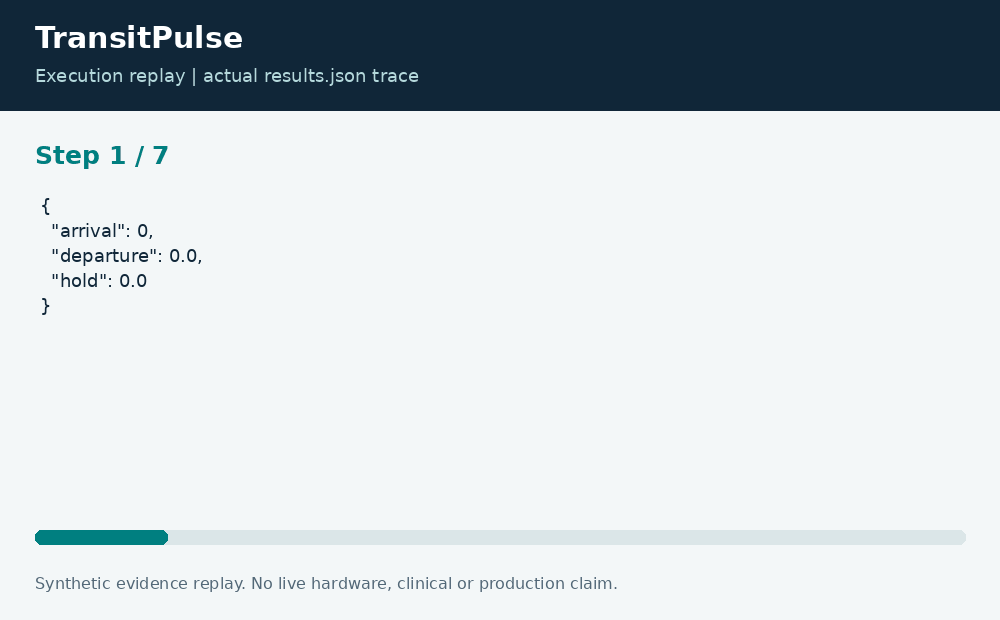

# TransitPulse: Bus Headway Holding Simulation

**Neco Thomas · Project Phoenix · Independent portfolio prototype**  
Implementation and editorial preparation assisted by AI. All inputs are synthetic. Results below come from the included local execution; they are not employment accomplishments or production outcomes.

## The decision worth solving

Bus regularity can improve at the expense of passengers already aboard a held vehicle. Reporting only a lower bunching metric would conceal that tradeoff. TransitPulse therefore publishes both headway error and the holding time used to obtain the result.

**Engineering question:** Can bounded holding reduce departure bunching without hiding passenger delay?

## What I am sharing

The Java simulation processes ordered arrivals at a fictional terminal. Each departure is no earlier than its arrival, no later than its maximum allowed hold, and as close as those limits permit to the prior departure plus a target interval. Python computes before-and-after headway root-mean-square error from the returned departure trace.



The project is self-contained: source, its own fixture, eight tests, a saved result, a technical diagram, a result chart, and an animated execution trace. It has no runtime dependency on the other nineteen projects. The common entry point is only a convenience for reviewers; the decision logic belongs to this project.

## Run the demonstration

Requirements: Python 3.12 or newer and Java 17 source-file launcher. The primary CLI uses only the Python standard library; native components require the named toolchain. No API keys, paid services, patient records, robot hardware, or cloud account are required.

```bash
python3 app.py
python3 -m unittest discover -s tests -v
```

On Windows use `python` or `py -3` if `python3` is not installed. Native C/C++ entry points currently expect the Linux GCC toolchain. Linux execution is verified; other operating systems are extension targets until separately tested. `run.ps1` and `run.sh` are convenience launchers, not evidence of OS certification.

## What the run actually showed

For the fixture, headway error falls from approximately 6.455 to 1.528 minutes, while the policy adds 20 total vehicle-minutes of hold. The expected departure sequence is asserted directly. Tests also check zero holding, a single bus, empty data, and invalid arrival ordering.

| Metric | Fixture result |
| --- | ---: |
| arrival headway rmse | 6.45497 |
| departure headway rmse | 1.52753 |
| total hold minutes | 20 |



The chart uses one stated measurement unit and is computed directly from the saved output. Exact values and the execution trace are in [results.json](results.json), and individual assertions are visible in [the test file](tests/test_project.py).



## The tradeoff and the boundary

This is a terminal policy demonstration, not a city-network optimization. Passenger counts, transfer reliability, dwell time, traffic feedback, driver constraints, and downstream stops are absent. The measured improvement applies to this synthetic arrival sequence only.

The test evidence supports behavior on the published cases. It does not establish production reliability or a universal performance estimate. Invalid inputs are rejected or represented explicitly according to the implementation; a reviewer should read the tested boundary cases before extending the input contract.

## How a team would move this forward

Transit operations should define allowable holding and service recovery policy. Analysts should measure passenger-weighted outcomes, while software engineers preserve replayability. The next step is a scenario panel that compares regularity, total passenger delay, missed transfers, and robustness across multiple demand patterns.

For a principal-level review, the useful handoff is the decision contract: who supplies each input, who interprets exceptions, who approves any real-world action, and what evidence would justify expanding the scope. That handoff is separate from the prototype run and remains a proposed next step.

## Reproduce and review

Each folder can be copied out and run independently. `validation.log` records the eight local assertions. Optional chart regeneration uses Pillow: install `requirements-visuals.txt`, then run `python3 visualize.py`. The figures replay saved results and do not fabricate measurements. Re-run the CLI before redrawing figures after changing a fixture.

Primary technical reference: [https://docs.oracle.com/en/java/javase/17/](https://docs.oracle.com/en/java/javase/17/). This reference informs the implementation context; it does not endorse or certify this project.

[Source and project files](https://github.com/bigneek78/data-platform-reliability-lab/tree/main/frontier-projects/07-transitpulse) · [All twenty projects](https://github.com/bigneek78/data-platform-reliability-lab/tree/main/frontier-projects)
