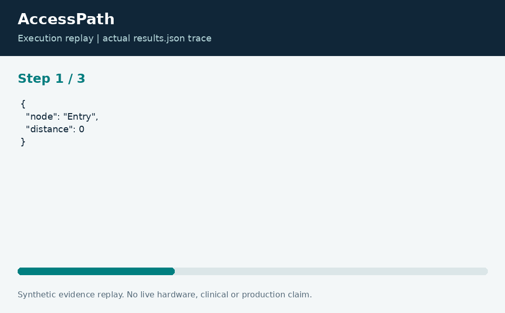

# AccessPath: Constraint-Aware Walking Routes

**Neco Thomas · Project Phoenix · Independent portfolio prototype**  
Implementation and editorial preparation assisted by AI. All inputs are synthetic. Results below come from the included local execution; they are not employment accomplishments or production outcomes.

## The decision worth solving

A shortest walking route is not useful if a segment violates the traveler stated constraints. A route tool needs to preserve the reasons it removed edges instead of presenting accessibility as an unexplained yes-or-no badge.

**Engineering question:** Which synthetic walking route meets a stated width and slope constraint while avoiding stairs?

## What I am sharing

AccessPath excludes edges marked as stairs, above a configured slope, or below a configured width. It then finds the shortest remaining directed route. The rejected-edge ledger records the relevant constraint names. All locations and dimensions in the fixture are fictional.


The project is self-contained: source, its own fixture, eight tests, a saved result, a technical diagram, a result chart, and an animated execution trace. It has no runtime dependency on the other nineteen projects. The common entry point is only a convenience for reviewers; the decision logic belongs to this project.

## Run the demonstration

Requirements: Python 3.12 or newer. The primary CLI uses only the Python standard library; native components require the named toolchain. No API keys, paid services, patient records, robot hardware, or cloud account are required.

```bash
python3 app.py
python3 -m unittest discover -s tests -v
```

On Windows use `python` or `py -3` if `python3` is not installed. Native C/C++ entry points currently expect the Linux GCC toolchain. Linux execution is verified; other operating systems are extension targets until separately tested. `run.ps1` and `run.sh` are convenience launchers, not evidence of OS certification.

## What the run actually showed

The fixture rejects the direct stairs and one steep ramp, then selects Entry, Lift, Exit with length 17. Raising the slope limit allows a length-12 alternative. Tests cover exact constraint boundaries, unreachable routes, unknown nodes, and negative lengths.

| Metric | Fixture result |
| --- | ---: |
| route length | 17 |
| excluded edges | 2 |


The chart uses one stated measurement unit and is computed directly from the saved output. Exact values and the execution trace are in [results.json](results.json), and individual assertions are visible in [the test file](tests/test_project.py).



## The tradeoff and the boundary

The configuration describes user-selected constraints rather than a legal accessibility standard or a guarantee that a physical route is safe. The graph omits surface condition, crosswalk timing, lift outages, temporary obstructions, and the measurement uncertainty of width and slope.

The test evidence supports behavior on the published cases. It does not establish production reliability or a universal performance estimate. Invalid inputs are rejected or represented explicitly according to the implementation; a reviewer should read the tested boundary cases before extending the input contract.

## How a team would move this forward

An accessibility specialist should review the constraint model with users; facilities staff should own survey freshness; engineering should retain source and revision metadata. The next milestone is a consent-based validation process and an outage-aware map, with a clear way to report a route that does not match conditions.

For a principal-level review, the useful handoff is the decision contract: who supplies each input, who interprets exceptions, who approves any real-world action, and what evidence would justify expanding the scope. That handoff is separate from the prototype run and remains a proposed next step.

## Reproduce and review

Each folder can be copied out and run independently. `validation.log` records the eight local assertions. Optional chart regeneration uses Pillow: install `requirements-visuals.txt`, then run `python3 visualize.py`. The figures replay saved results and do not fabricate measurements. Re-run the CLI before redrawing figures after changing a fixture.

Primary technical reference: [https://docs.python.org/3/library/heapq.html](https://docs.python.org/3/library/heapq.html). This reference informs the implementation context; it does not endorse or certify this project.

[Source and project files](https://github.com/bigneek78/data-platform-reliability-lab/tree/main/frontier-projects/08-accesspath) · [All twenty projects](https://github.com/bigneek78/data-platform-reliability-lab/tree/main/frontier-projects)
