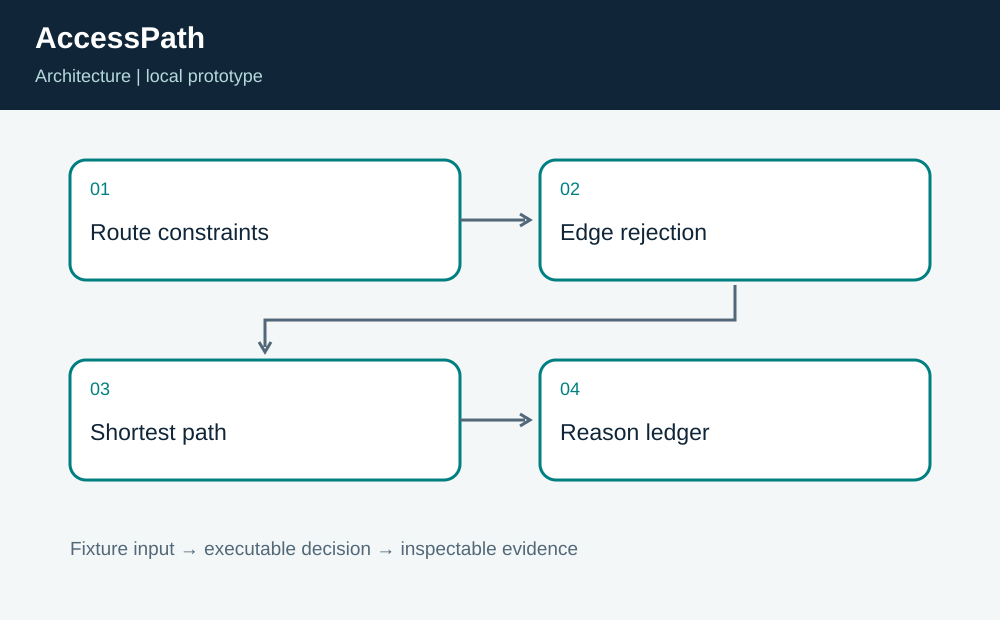
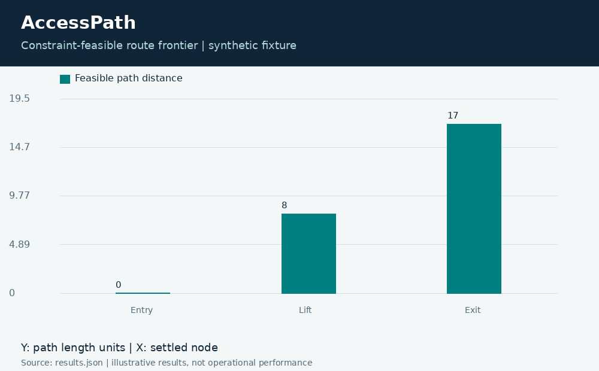

# AccessPath: Constraint-Aware Walking Routes

**Independent project 08 of 20 · Accessible transportation · Python**

Prepared for Neco Thomas with AI assistance. Synthetic portfolio prototype; no production, clinical, physical-hardware, or employer-delivery claim.

Which synthetic walking route meets a stated width and slope constraint while avoiding stairs?

**Method:** Filtered directed-graph shortest path with explicit rejected-edge reasons.

**Observed result:** The fixture rejects the direct stairs and one steep ramp, then selects Entry, Lift, Exit with length 17. Raising the slope limit allows a length-12 alternative. Tests cover exact constraint boundaries, unreachable routes, unknown nodes, and negative lengths.



## Run this project on its own

Requirements: Python 3.12 or newer. No other project folder is imported.

```bash
python3 app.py
python3 -m unittest discover -s tests -v
```

**Local validation: 8 tests passed.** The CLI and all required native components executed on Linux. See [validation.log](validation.log) and [results.json](results.json). Optional figures need Pillow; application/tests otherwise use standard-library Python plus the named native toolchain.

| Metric | Result |
| --- | ---: |
| route length | 17 |
| excluded edges | 2 |



## Engineering boundary

The configuration describes user-selected constraints rather than a legal accessibility standard or a guarantee that a physical route is safe. The graph omits surface condition, crosswalk timing, lift outages, temporary obstructions, and the measurement uncertainty of width and slope.

## Team handoff

An accessibility specialist should review the constraint model with users; facilities staff should own survey freshness; engineering should retain source and revision metadata. The next milestone is a consent-based validation process and an outage-aware map, with a clear way to report a route that does not match conditions.

Read the [complete article](ARTICLE.md), inspect the [tests](tests/test_project.py), or view the [animated result trace](assets/replay.gif). The [manifest](project.json) identifies this standalone project. Configurations for CI and containers are supplied as configurations; their status is tracked separately from local execution.

Primary reference: https://docs.python.org/3/library/heapq.html
