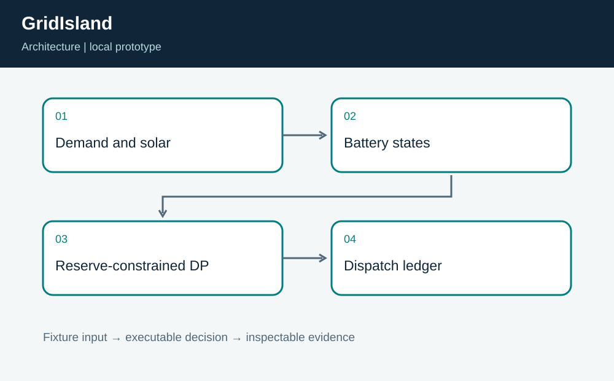
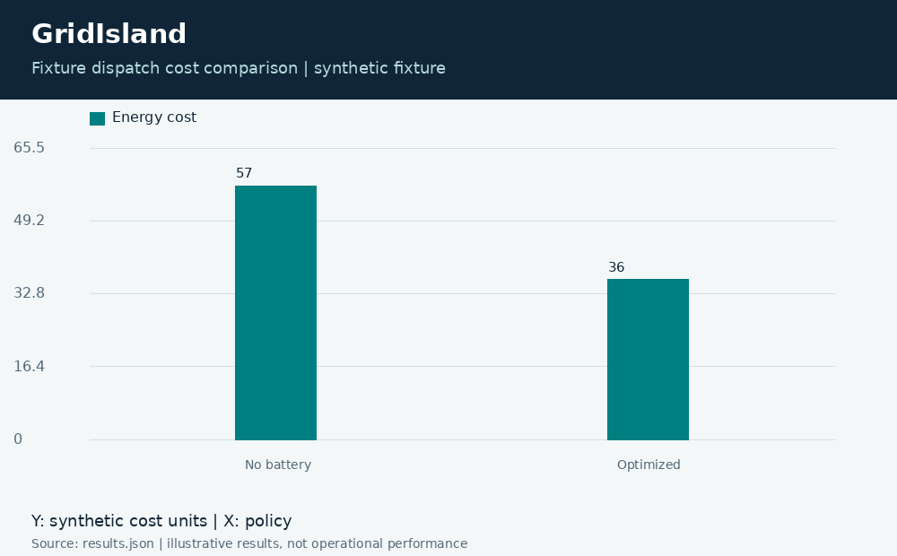
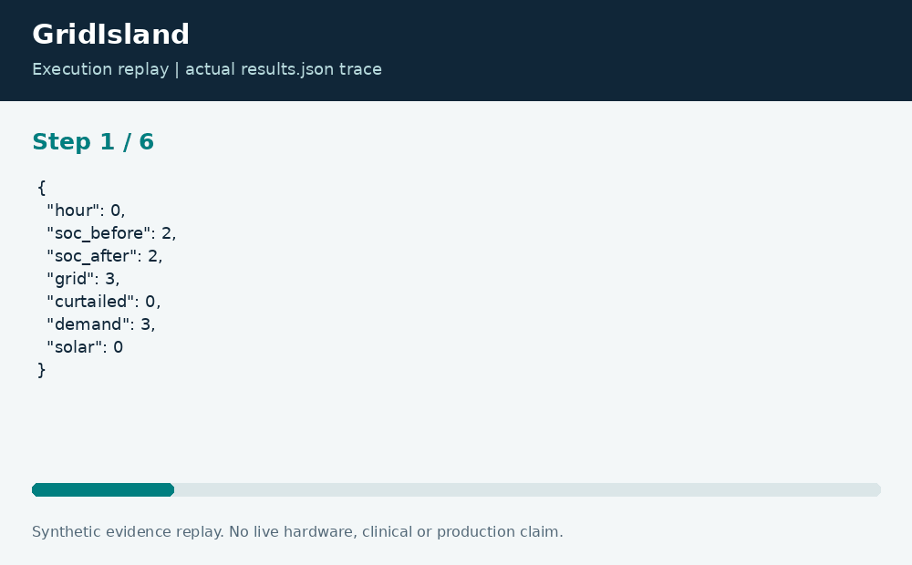

# GridIsland: Reserve-Constrained Microgrid Dispatch

**Neco Thomas · Project Phoenix · Independent portfolio prototype**  
Implementation and editorial preparation assisted by AI. All inputs are synthetic. Results below come from the included local execution; they are not employment accomplishments or production outcomes.

## The decision worth solving

Cheap energy is not the only objective of a microgrid. A battery dispatch that empties the reserve can undermine the resilience the battery was purchased to provide. GridIsland makes both the minimum reserve and the final state of charge explicit constraints.

**Engineering question:** When should an idealized battery charge or discharge while retaining a stated reserve?

## What I am sharing

A dynamic program enumerates feasible integer-kWh battery states for each one-hour slot. Every transition respects battery capacity, a charge-or-discharge limit, a grid import limit, and energy balance. The terminal state must satisfy the configured requirement. Solar surplus can be curtailed; exports receive no revenue.



The project is self-contained: source, its own fixture, eight tests, a saved result, a technical diagram, a result chart, and an animated execution trace. It has no runtime dependency on the other nineteen projects. The common entry point is only a convenience for reviewers; the decision logic belongs to this project.

## Run the demonstration

Requirements: Python 3.12 or newer. The primary CLI uses only the Python standard library; native components require the named toolchain. No API keys, paid services, patient records, robot hardware, or cloud account are required.

```bash
python3 app.py
python3 -m unittest discover -s tests -v
```

On Windows use `python` or `py -3` if `python3` is not installed. Native C/C++ entry points currently expect the Linux GCC toolchain. Linux execution is verified; other operating systems are extension targets until separately tested. `run.ps1` and `run.sh` are convenience launchers, not evidence of OS certification.

## What the run actually showed

The fixture dispatch costs 36 units versus 57 with no battery operation, and ends at state of charge 2. Tests verify each energy-balance equation, reserve and rate bounds, terminal state, a tiny independently known optimum, and explicit failure when grid limits make service impossible.

| Metric | Fixture result |
| --- | ---: |
| dispatch cost units | 36 |
| no battery cost units | 57 |
| terminal soc | 2 |
| imported kwh | 12 |



The chart uses one stated measurement unit and is computed directly from the saved output. Exact values and the execution trace are in [results.json](results.json), and individual assertions are visible in [the test file](tests/test_project.py).



## The tradeoff and the boundary

The model assumes ideal 100-percent battery efficiency. It excludes degradation, conversion losses, forecasts, ramping limits, outages, and power-flow constraints. The cost difference is an algorithm demonstration, not a forecast of a real site savings or a purchasing recommendation.

The test evidence supports behavior on the published cases. It does not establish production reliability or a universal performance estimate. Invalid inputs are rejected or represented explicitly according to the implementation; a reviewer should read the tested boundary cases before extending the input contract.

## How a team would move this forward

Energy engineers should own the physical battery model and safety limits. Facilities should define critical load, while operations and finance should approve resilience and cost priorities. Before a pilot, add efficiency and degradation, then test forecast error and outage scenarios against measured site demand.

For a principal-level review, the useful handoff is the decision contract: who supplies each input, who interprets exceptions, who approves any real-world action, and what evidence would justify expanding the scope. That handoff is separate from the prototype run and remains a proposed next step.

## Reproduce and review

Each folder can be copied out and run independently. `validation.log` records the eight local assertions. Optional chart regeneration uses Pillow: install `requirements-visuals.txt`, then run `python3 visualize.py`. The figures replay saved results and do not fabricate measurements. Re-run the CLI before redrawing figures after changing a fixture.

Primary technical reference: [https://docs.python.org/3/library/itertools.html](https://docs.python.org/3/library/itertools.html). This reference informs the implementation context; it does not endorse or certify this project.

[Source and project files](https://github.com/bigneek78/data-platform-reliability-lab/tree/main/frontier-projects/09-gridisland) · [All twenty projects](https://github.com/bigneek78/data-platform-reliability-lab/tree/main/frontier-projects)
