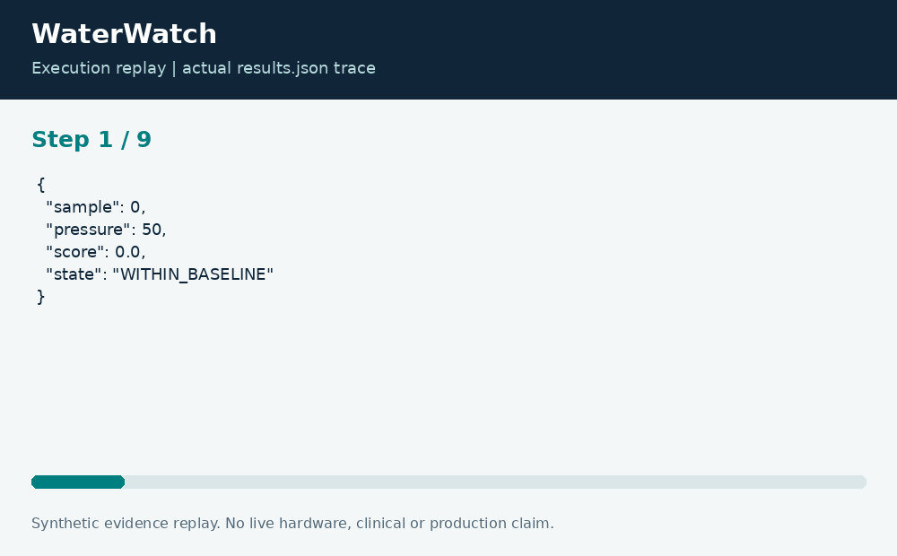

# WaterWatch: Pressure Anomaly Review

**Neco Thomas · Project Phoenix · Independent portfolio prototype**  
Implementation and editorial preparation assisted by AI. All inputs are synthetic. Results below come from the included local execution; they are not employment accomplishments or production outcomes.

## The decision worth solving

A missing pressure reading is not evidence of normal pressure. Infrastructure review tools need to distinguish unexpected observations from gaps in observation. WaterWatch keeps those states separate and avoids turning a sensor anomaly into an unsupported conclusion about water quality.

**Engineering question:** Which synthetic pressure readings deserve review when sensors can be missing or unusually noisy?

## What I am sharing

The detector estimates a baseline median and a scaled median absolute deviation. A configured measurement-resolution floor prevents a constant calibration window from creating a zero denominator. New readings receive a robust deviation score; absent values produce an explicit UNKNOWN record.


The project is self-contained: source, its own fixture, eight tests, a saved result, a technical diagram, a result chart, and an animated execution trace. It has no runtime dependency on the other nineteen projects. The common entry point is only a convenience for reviewers; the decision logic belongs to this project.

## Run the demonstration

Requirements: Python 3.12 or newer. The primary CLI uses only the Python standard library; native components require the named toolchain. No API keys, paid services, patient records, robot hardware, or cloud account are required.

```bash
python3 app.py
python3 -m unittest discover -s tests -v
```

On Windows use `python` or `py -3` if `python3` is not installed. Native C/C++ entry points currently expect the Linux GCC toolchain. Linux execution is verified; other operating systems are extension targets until separately tested. `run.ps1` and `run.sh` are convenience launchers, not evidence of OS certification.

## What the run actually showed

The synthetic sequence contains two low-pressure readings marked REVIEW, one UNKNOWN reading, and eight observed readings. Tests check the zero-variation calibration case, a single extreme calibration point, exact threshold equality, negative measurements, and insufficient baseline evidence.

| Metric | Fixture result |
| --- | ---: |
| review readings | 2 |
| unknown readings | 1 |
| observed readings | 8 |


The chart uses one stated measurement unit and is computed directly from the saved output. Exact values and the execution trace are in [results.json](results.json), and individual assertions are visible in [the test file](tests/test_project.py).



## The tradeoff and the boundary

The score is a deviation from this baseline, not a probability of a leak and not a potability assessment. A changed pump regime or sensor fault could produce the same pattern. Baseline selection and threshold calibration require field-specific evidence.

The test evidence supports behavior on the published cases. It does not establish production reliability or a universal performance estimate. Invalid inputs are rejected or represented explicitly according to the implementation; a reviewer should read the tested boundary cases before extending the input contract.

## How a team would move this forward

Water operations should interpret events with maintenance history and network context. Instrumentation staff should own sensor calibration, while data engineering should track time alignment and dropouts. The next milestone is a labeled replay study that separates confirmed leaks, maintenance activity, communication loss, and instrumentation faults.

For a principal-level review, the useful handoff is the decision contract: who supplies each input, who interprets exceptions, who approves any real-world action, and what evidence would justify expanding the scope. That handoff is separate from the prototype run and remains a proposed next step.

## Reproduce and review

Each folder can be copied out and run independently. `validation.log` records the eight local assertions. Optional chart regeneration uses Pillow: install `requirements-visuals.txt`, then run `python3 visualize.py`. The figures replay saved results and do not fabricate measurements. Re-run the CLI before redrawing figures after changing a fixture.

Primary technical reference: [https://docs.python.org/3/library/statistics.html](https://docs.python.org/3/library/statistics.html). This reference informs the implementation context; it does not endorse or certify this project.

[Source and project files](https://github.com/bigneek78/data-platform-reliability-lab/tree/main/frontier-projects/10-waterwatch) · [All twenty projects](https://github.com/bigneek78/data-platform-reliability-lab/tree/main/frontier-projects)
