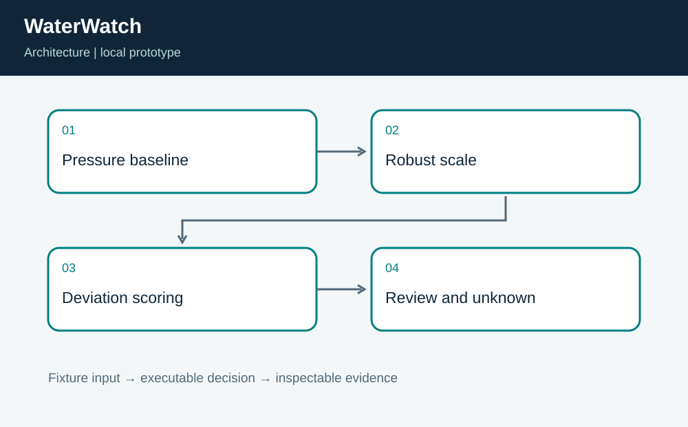
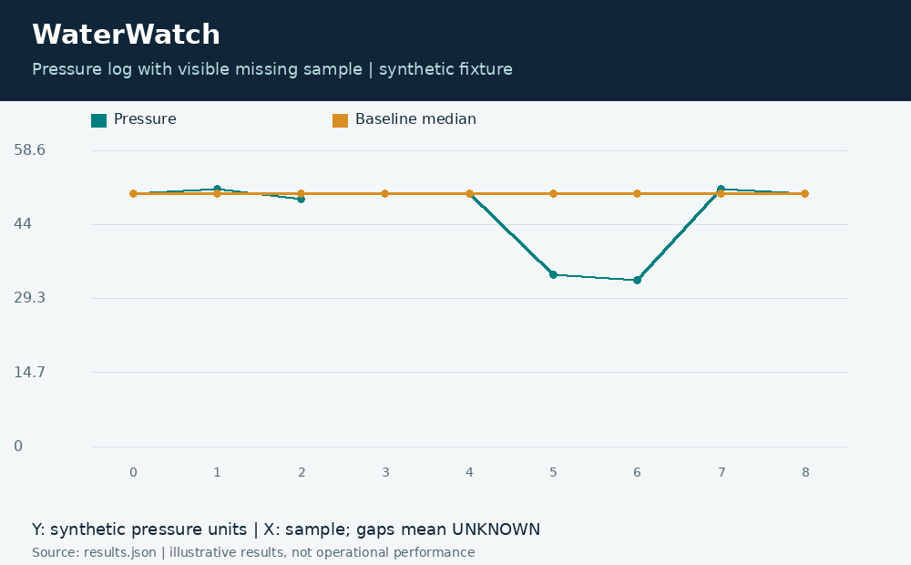

# WaterWatch: Pressure Anomaly Review

**Independent project 10 of 20 · Water infrastructure · Python**

Prepared for Neco Thomas with AI assistance. Synthetic portfolio prototype; no production, clinical, physical-hardware, or employer-delivery claim.

Which synthetic pressure readings deserve review when sensors can be missing or unusually noisy?

**Method:** Median absolute deviation detector with a measurement-resolution floor and explicit UNKNOWN states.

**Observed result:** The synthetic sequence contains two low-pressure readings marked REVIEW, one UNKNOWN reading, and eight observed readings. Tests check the zero-variation calibration case, a single extreme calibration point, exact threshold equality, negative measurements, and insufficient baseline evidence.



## Run this project on its own

Requirements: Python 3.12 or newer. No other project folder is imported.

```bash
python3 app.py
python3 -m unittest discover -s tests -v
```

**Local validation: 8 tests passed.** The CLI and all required native components executed on Linux. See [validation.log](validation.log) and [results.json](results.json). Optional figures need Pillow; application/tests otherwise use standard-library Python plus the named native toolchain.

| Metric | Result |
| --- | ---: |
| review readings | 2 |
| unknown readings | 1 |
| observed readings | 8 |



## Engineering boundary

The score is a deviation from this baseline, not a probability of a leak and not a potability assessment. A changed pump regime or sensor fault could produce the same pattern. Baseline selection and threshold calibration require field-specific evidence.

## Team handoff

Water operations should interpret events with maintenance history and network context. Instrumentation staff should own sensor calibration, while data engineering should track time alignment and dropouts. The next milestone is a labeled replay study that separates confirmed leaks, maintenance activity, communication loss, and instrumentation faults.

Read the [complete article](ARTICLE.md), inspect the [tests](tests/test_project.py), or view the [animated result trace](assets/replay.gif). The [manifest](project.json) identifies this standalone project. Configurations for CI and containers are supplied as configurations; their status is tracked separately from local execution.

Primary reference: https://docs.python.org/3/library/statistics.html
