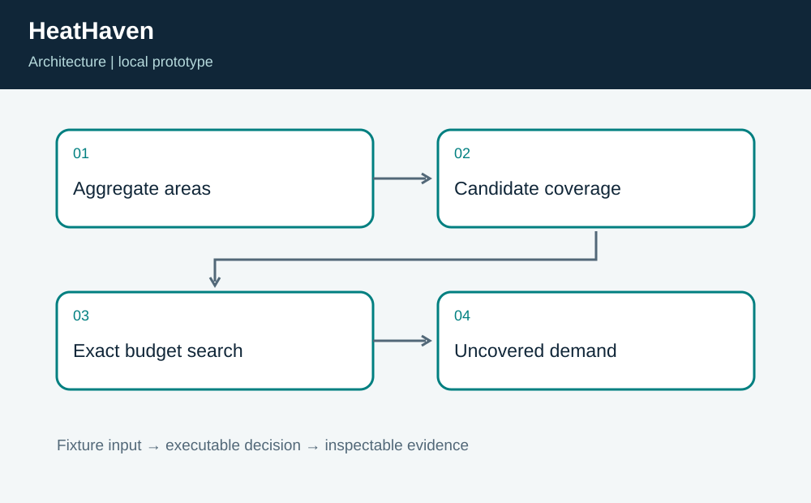
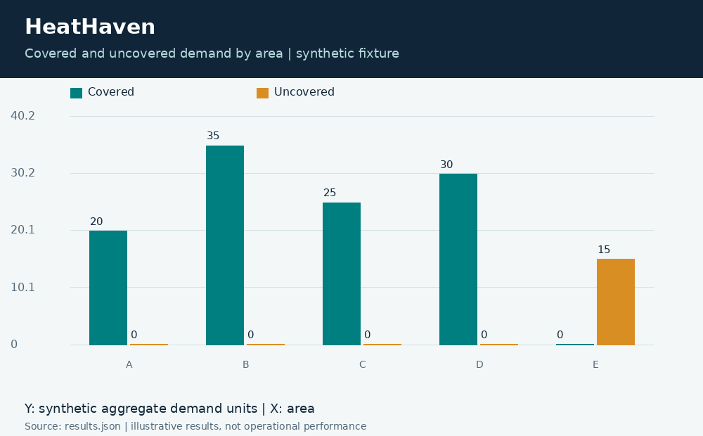
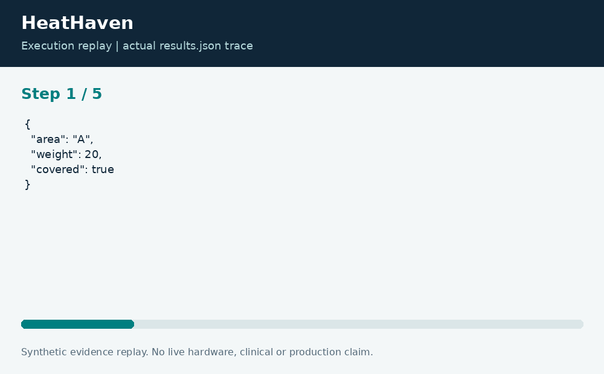

# HeatHaven: Cooling-Center Coverage Planning

**Neco Thomas · Project Phoenix · Independent portfolio prototype**  
Implementation and editorial preparation assisted by AI. All inputs are synthetic. Results below come from the included local execution; they are not employment accomplishments or production outcomes.

## The decision worth solving

Opening the nearest center to every neighborhood may exceed a city operating budget. A useful planning exercise should show what a chosen budget can cover, what remains uncovered, and whether a simple heuristic is leaving value behind.

**Engineering question:** Which small set of candidate cooling centers covers the most synthetic neighborhood demand?

## What I am sharing

HeatHaven evaluates candidate-center subsets on a fictional Manhattan grid. Each area has an aggregate demand weight; a center covers areas within the configured radius. The exact small-case search maximizes covered demand without double counting overlapping areas. A greedy comparator is evaluated on the same fixture.



The project is self-contained: source, its own fixture, eight tests, a saved result, a technical diagram, a result chart, and an animated execution trace. It has no runtime dependency on the other nineteen projects. The common entry point is only a convenience for reviewers; the decision logic belongs to this project.

## Run the demonstration

Requirements: Python 3.12 or newer. The primary CLI uses only the Python standard library; native components require the named toolchain. No API keys, paid services, patient records, robot hardware, or cloud account are required.

```bash
python3 app.py
python3 -m unittest discover -s tests -v
```

On Windows use `python` or `py -3` if `python3` is not installed. Native C/C++ entry points currently expect the Linux GCC toolchain. Linux execution is verified; other operating systems are extension targets until separately tested. `run.ps1` and `run.sh` are convenience launchers, not evidence of OS certification.

## What the run actually showed

Two selected centers cover 110 of 125 synthetic demand units. Area E remains explicitly uncovered. Greedy ties the exact result on this fixture, so the project does not claim a heuristic improvement. Tests cover zero budget, radius equality, overlapping coverage, and negative demand rejection.

| Metric | Fixture result |
| --- | ---: |
| covered demand | 110 |
| total demand | 125 |
| greedy covered demand | 110 |



The chart uses one stated measurement unit and is computed directly from the saved output. Exact values and the execution trace are in [results.json](results.json), and individual assertions are visible in [the test file](tests/test_project.py).



## The tradeoff and the boundary

The model does not include center capacity, staffing, public transit, accessible entrances, weather forecasts, or individual medical vulnerability. Aggregate weights are invented; no real person is ranked or assigned access. The exact search is bounded to 18 candidates.

The test evidence supports behavior on the published cases. It does not establish production reliability or a universal performance estimate. Invalid inputs are rejected or represented explicitly according to the implementation; a reviewer should read the tested boundary cases before extending the input contract.

## How a team would move this forward

Community organizations should define the service objective with residents. Facilities and accessibility teams should validate candidate sites, while analysts evaluate unmet coverage and capacity. The next milestone is an independently reviewed capacity-and-travel model using appropriate aggregate data and a documented process for community feedback.

For a principal-level review, the useful handoff is the decision contract: who supplies each input, who interprets exceptions, who approves any real-world action, and what evidence would justify expanding the scope. That handoff is separate from the prototype run and remains a proposed next step.

## Reproduce and review

Each folder can be copied out and run independently. `validation.log` records the eight local assertions. Optional chart regeneration uses Pillow: install `requirements-visuals.txt`, then run `python3 visualize.py`. The figures replay saved results and do not fabricate measurements. Re-run the CLI before redrawing figures after changing a fixture.

Primary technical reference: [https://docs.python.org/3/library/itertools.html](https://docs.python.org/3/library/itertools.html). This reference informs the implementation context; it does not endorse or certify this project.

[Source and project files](https://github.com/bigneek78/data-platform-reliability-lab/tree/main/frontier-projects/11-heathaven) · [All twenty projects](https://github.com/bigneek78/data-platform-reliability-lab/tree/main/frontier-projects)
