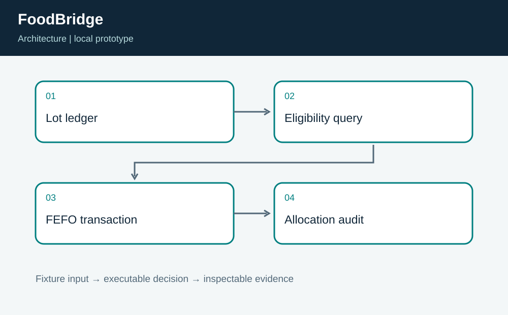
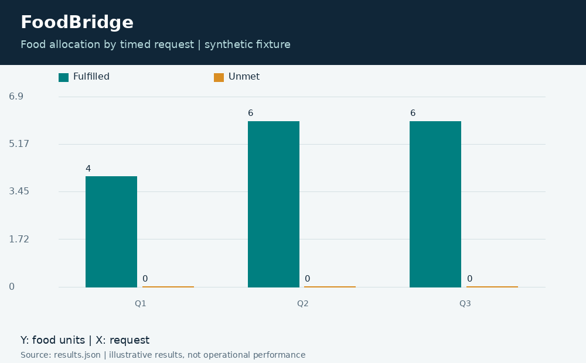
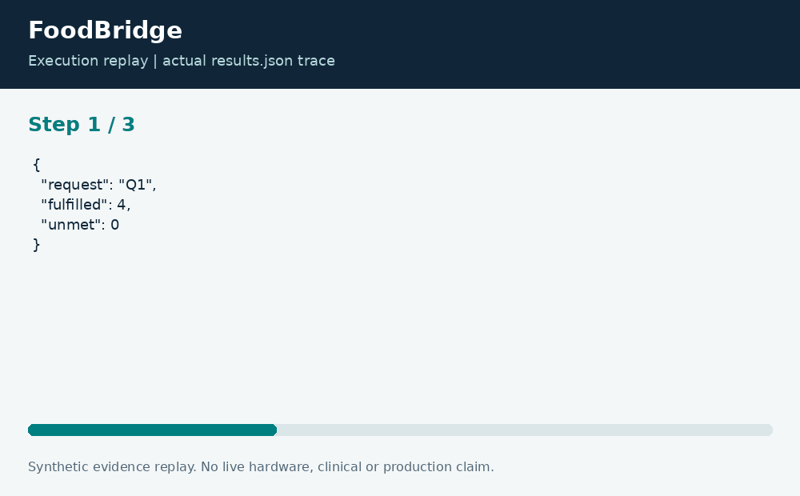

# FoodBridge: Perishable Inventory Allocation

**Neco Thomas · Project Phoenix · Independent portfolio prototype**  
Implementation and editorial preparation assisted by AI. All inputs are synthetic. Results below come from the included local execution; they are not employment accomplishments or production outcomes.

## The decision worth solving

Perishable inventory planning needs an audit trail at the lot level. A total-fulfilled chart can hide the use of an expired lot or stock that had not arrived. FoodBridge keeps availability and expiry inside the allocation query.

**Engineering question:** Can a food-rescue desk fulfill timed requests while keeping expired lots out of allocations?

## What I am sharing

A transient SQLite database stores synthetic lots with nonnegative units and valid availability-to-expiry windows. Requests are processed by time and identifier. Eligible lots must already be available and must expire strictly after the request time. Parameterized SQL allocates first-expiring stock first within a transaction.



The project is self-contained: source, its own fixture, eight tests, a saved result, a technical diagram, a result chart, and an animated execution trace. It has no runtime dependency on the other nineteen projects. The common entry point is only a convenience for reviewers; the decision logic belongs to this project.

## Run the demonstration

Requirements: Python 3.12 or newer. The primary CLI uses only the Python standard library; native components require the named toolchain. No API keys, paid services, patient records, robot hardware, or cloud account are required.

```bash
python3 app.py
python3 -m unittest discover -s tests -v
```

On Windows use `python` or `py -3` if `python3` is not installed. Native C/C++ entry points currently expect the Linux GCC toolchain. Linux execution is verified; other operating systems are extension targets until separately tested. `run.ps1` and `run.sh` are convenience launchers, not evidence of OS certification.

## What the run actually showed

The demonstration fulfills 16 requested units, leaves 1 unit, and reports that remaining unit as expired at the reporting horizon. Tests reconcile supply and demand, verify expiry and availability boundaries, and prove that a punctuation-heavy identifier is treated as data rather than SQL.

| Metric | Fixture result |
| --- | ---: |
| allocated units | 16 |
| unmet units | 0 |
| remaining units | 1 |
| expired remaining units | 1 |



The chart uses one stated measurement unit and is computed directly from the saved output. Exact values and the execution trace are in [results.json](results.json), and individual assertions are visible in [the test file](tests/test_project.py).



## The tradeoff and the boundary

This is a desk allocation model, not a food-safety certification or delivery optimizer. Food types, allergens, handling temperature, nutrition, vehicle routes, and recipient preferences are absent. First-expiring-first-out is not a global proof of minimum waste across all possible future requests.

The test evidence supports behavior on the published cases. It does not establish production reliability or a universal performance estimate. Invalid inputs are rejected or represented explicitly according to the implementation; a reviewer should read the tested boundary cases before extending the input contract.

## How a team would move this forward

Warehouse staff should own lot evidence, partner organizations should validate requests, and logistics staff should supply transport constraints. The next milestone is a replay with item compatibility and delivery windows, followed by reconciliation between promised, picked, delivered, and rejected units.

For a principal-level review, the useful handoff is the decision contract: who supplies each input, who interprets exceptions, who approves any real-world action, and what evidence would justify expanding the scope. That handoff is separate from the prototype run and remains a proposed next step.

## Reproduce and review

Each folder can be copied out and run independently. `validation.log` records the eight local assertions. Optional chart regeneration uses Pillow: install `requirements-visuals.txt`, then run `python3 visualize.py`. The figures replay saved results and do not fabricate measurements. Re-run the CLI before redrawing figures after changing a fixture.

Primary technical reference: [https://docs.python.org/3/library/sqlite3.html](https://docs.python.org/3/library/sqlite3.html). This reference informs the implementation context; it does not endorse or certify this project.

[Source and project files](https://github.com/bigneek78/data-platform-reliability-lab/tree/main/frontier-projects/12-foodbridge) · [All twenty projects](https://github.com/bigneek78/data-platform-reliability-lab/tree/main/frontier-projects)
