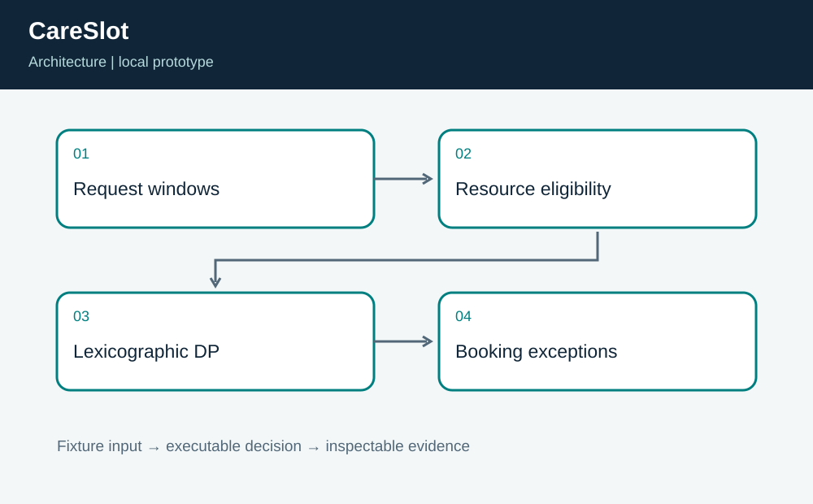
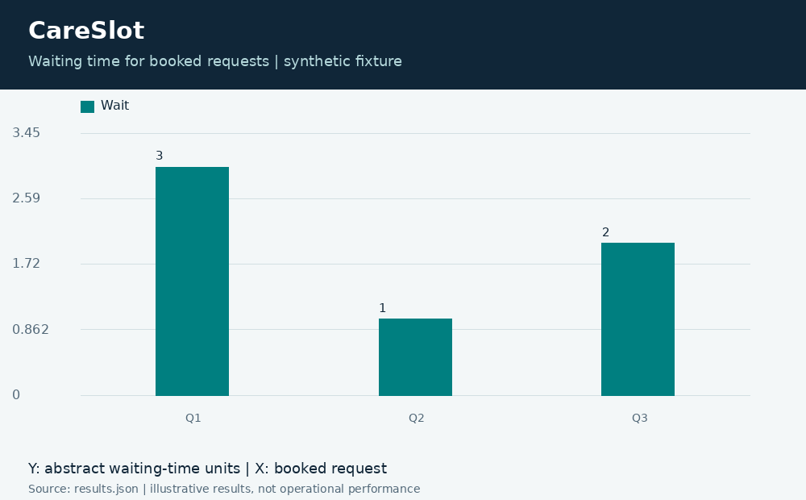
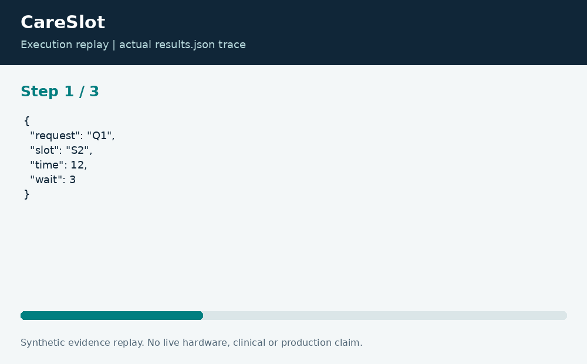

# CareSlot: Clinic Resource Scheduling

**Neco Thomas · Project Phoenix · Independent portfolio prototype**  
Implementation and editorial preparation assisted by AI. All inputs are synthetic. Results below come from the included local execution; they are not employment accomplishments or production outcomes.

## The decision worth solving

An appointment desk can accidentally consume a scarce scanner slot for a request that only needs a room. That local choice can reduce the total number of requests accommodated. CareSlot demonstrates the resource-allocation issue without making clinical priority decisions.

**Engineering question:** Can an appointment desk book more requests when available resources differ by slot?

## What I am sharing

Each synthetic request states an earliest and latest acceptable time and a set of required resources. Each slot has a time and available resources. The exact subset dynamic program maximizes the number booked, then minimizes total waiting time among maximum-booking solutions. Unbooked requests remain visible.



The project is self-contained: source, its own fixture, eight tests, a saved result, a technical diagram, a result chart, and an animated execution trace. It has no runtime dependency on the other nineteen projects. The common entry point is only a convenience for reviewers; the decision logic belongs to this project.

## Run the demonstration

Requirements: Python 3.12 or newer. The primary CLI uses only the Python standard library; native components require the named toolchain. No API keys, paid services, patient records, robot hardware, or cloud account are required.

```bash
python3 app.py
python3 -m unittest discover -s tests -v
```

On Windows use `python` or `py -3` if `python3` is not installed. Native C/C++ entry points currently expect the Linux GCC toolchain. Linux execution is verified; other operating systems are extension targets until separately tested. `run.ps1` and `run.sh` are convenience launchers, not evidence of OS certification.

## What the run actually showed

Three of four fixture requests are booked, with a total wait of 6 abstract time units. The specialized Q2 request receives S1, and the unavailable Q4 request remains unbooked. Tests cover slot uniqueness, resource preservation, inclusive time boundaries, empty capacity, and invalid windows.

| Metric | Fixture result |
| --- | ---: |
| booked | 3 |
| unbooked | 1 |
| total wait units | 6 |



The chart uses one stated measurement unit and is computed directly from the saved output. Exact values and the execution trace are in [results.json](results.json), and individual assertions are visible in [the test file](tests/test_project.py).



## The tradeoff and the boundary

The objective is an operations illustration. It does not assess symptoms, urgency, insurance, protected characteristics, or access eligibility. It ignores appointment durations, staffing overlap, cancellations, and patient preferences beyond the supplied window. It is bounded to 16 requests and slots.

The test evidence supports behavior on the published cases. It does not establish production reliability or a universal performance estimate. Invalid inputs are rejected or represented explicitly according to the implementation; a reviewer should read the tested boundary cases before extending the input contract.

## How a team would move this forward

Scheduling staff and clinical operations should define a reviewed service policy before any real data is introduced. Engineering should preserve exceptions and explain unbooked outcomes. The next milestone is a validated duration-and-resource model with human scheduling authority and explicit accommodation workflows.

For a principal-level review, the useful handoff is the decision contract: who supplies each input, who interprets exceptions, who approves any real-world action, and what evidence would justify expanding the scope. That handoff is separate from the prototype run and remains a proposed next step.

## Reproduce and review

Each folder can be copied out and run independently. `validation.log` records the eight local assertions. Optional chart regeneration uses Pillow: install `requirements-visuals.txt`, then run `python3 visualize.py`. The figures replay saved results and do not fabricate measurements. Re-run the CLI before redrawing figures after changing a fixture.

Primary technical reference: [https://docs.python.org/3/library/functools.html](https://docs.python.org/3/library/functools.html). This reference informs the implementation context; it does not endorse or certify this project.

[Source and project files](https://github.com/bigneek78/data-platform-reliability-lab/tree/main/frontier-projects/13-careslot) · [All twenty projects](https://github.com/bigneek78/data-platform-reliability-lab/tree/main/frontier-projects)
