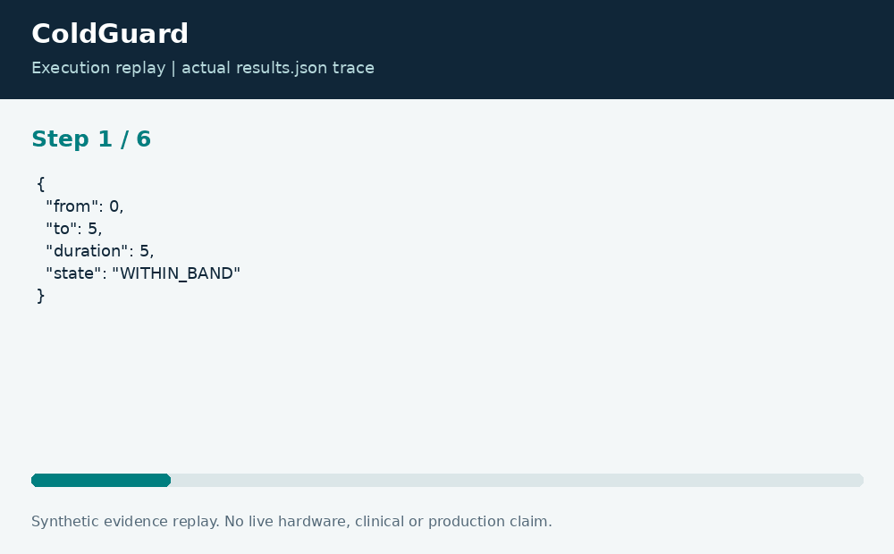

# ColdGuard: Cold-Chain Evidence Review

**Neco Thomas · Project Phoenix · Independent portfolio prototype**  
Implementation and editorial preparation assisted by AI. All inputs are synthetic. Results below come from the included local execution; they are not employment accomplishments or production outcomes.

## The decision worth solving

A cold-chain record can be incomplete even when the visible temperatures look ordinary. Treating missing intervals as compliant would create false confidence. ColdGuard reports excursions and gaps as different types of evidence requiring review.

**Engineering question:** How much logged time is outside an illustrative storage band, and where is the evidence incomplete?

## What I am sharing

The prototype reads an illustrative XML band and an ordered synthetic temperature log. Each adjacent sample pair defines an interval. A missing endpoint or a gap longer than the allowed logging interval produces UNKNOWN time. Otherwise, the left sample classifies that interval as within band or an excursion.


The project is self-contained: source, its own fixture, eight tests, a saved result, a technical diagram, a result chart, and an animated execution trace. It has no runtime dependency on the other nineteen projects. The common entry point is only a convenience for reviewers; the decision logic belongs to this project.

## Run the demonstration

Requirements: Python 3.12 or newer. The primary CLI uses only the Python standard library; native components require the named toolchain. No API keys, paid services, patient records, robot hardware, or cloud account are required.

```bash
python3 app.py
python3 -m unittest discover -s tests -v
```

On Windows use `python` or `py -3` if `python3` is not installed. Native C/C++ entry points currently expect the Linux GCC toolchain. Linux execution is verified; other operating systems are extension targets until separately tested. `run.ps1` and `run.sh` are convenience launchers, not evidence of OS certification.

## What the run actually showed

The 30-minute fixture contains 5 excursion minutes, 10 unknown minutes, and 15 within-band minutes. The outcome is HOLD_FOR_REVIEW. The totals reconcile exactly. Tests cover missing samples, long gaps, duplicate timestamps, the band boundary, and the insufficiency of a single sample.

| Metric | Fixture result |
| --- | ---: |
| outside minutes | 5 |
| unknown minutes | 10 |
| within minutes | 15 |
| elapsed minutes | 30 |


The chart uses one stated measurement unit and is computed directly from the saved output. Exact values and the execution trace are in [results.json](results.json), and individual assertions are visible in [the test file](tests/test_project.py).



## The tradeoff and the boundary

The 2-to-8 illustrative band is not a storage instruction for any product. The code does not judge vaccine potency, medicine suitability, food safety, or permission to release stock. Left-sample integration is an explicit approximation, not a claim that the temperature was continuously known.

The test evidence supports behavior on the published cases. It does not establish production reliability or a universal performance estimate. Invalid inputs are rejected or represented explicitly according to the implementation; a reviewer should read the tested boundary cases before extending the input contract.

## How a team would move this forward

Quality staff should own product-specific requirements and disposition authority. Logistics should preserve calibrated logger evidence, while engineering should make time-zone and clock assumptions explicit. A next milestone is a product-specific, independently reviewed policy model and reconciliation against calibrated continuous reference data.

For a principal-level review, the useful handoff is the decision contract: who supplies each input, who interprets exceptions, who approves any real-world action, and what evidence would justify expanding the scope. That handoff is separate from the prototype run and remains a proposed next step.

## Reproduce and review

Each folder can be copied out and run independently. `validation.log` records the eight local assertions. Optional chart regeneration uses Pillow: install `requirements-visuals.txt`, then run `python3 visualize.py`. The figures replay saved results and do not fabricate measurements. Re-run the CLI before redrawing figures after changing a fixture.

Primary technical reference: [https://docs.python.org/3/library/xml.etree.elementtree.html](https://docs.python.org/3/library/xml.etree.elementtree.html). This reference informs the implementation context; it does not endorse or certify this project.

[Source and project files](https://github.com/bigneek78/data-platform-reliability-lab/tree/main/frontier-projects/14-coldguard) · [All twenty projects](https://github.com/bigneek78/data-platform-reliability-lab/tree/main/frontier-projects)
