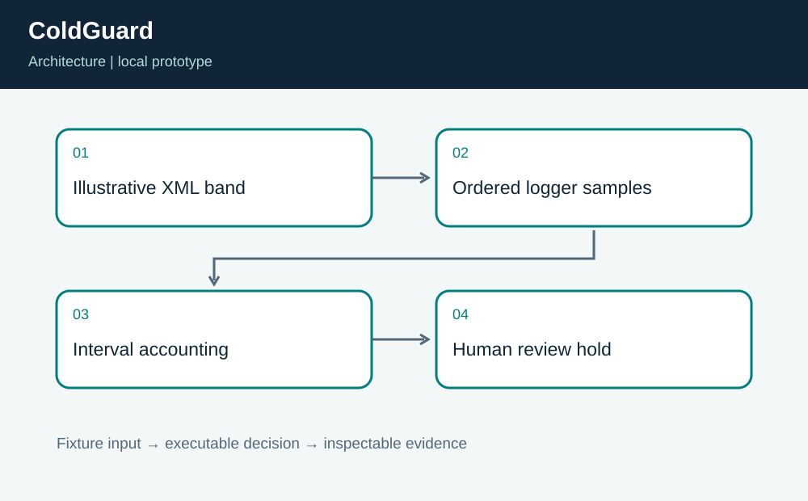
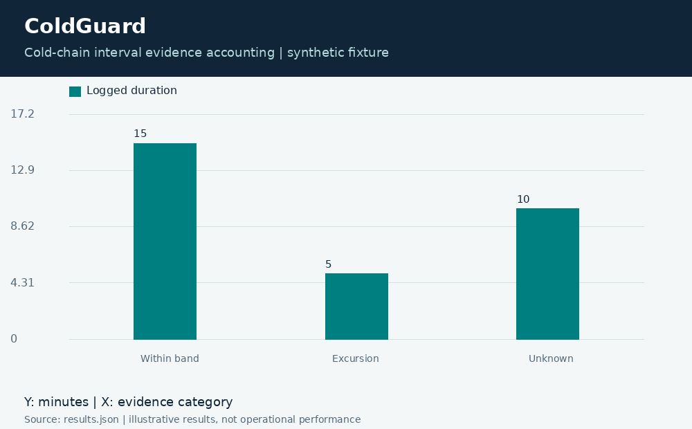

# ColdGuard: Cold-Chain Evidence Review

**Independent project 14 of 20 · Healthcare logistics · Python + XML**

Prepared for Neco Thomas with AI assistance. Synthetic portfolio prototype; no production, clinical, physical-hardware, or employer-delivery claim.

How much logged time is outside an illustrative storage band, and where is the evidence incomplete?

**Method:** Left-sample interval integration with separate excursion and unknown-duration ledgers.

**Observed result:** The 30-minute fixture contains 5 excursion minutes, 10 unknown minutes, and 15 within-band minutes. The outcome is HOLD_FOR_REVIEW. The totals reconcile exactly. Tests cover missing samples, long gaps, duplicate timestamps, the band boundary, and the insufficiency of a single sample.



## Run this project on its own

Requirements: Python 3.12 or newer. No other project folder is imported.

```bash
python3 app.py
python3 -m unittest discover -s tests -v
```

**Local validation: 8 tests passed.** The CLI and all required native components executed on Linux. See [validation.log](validation.log) and [results.json](results.json). Optional figures need Pillow; application/tests otherwise use standard-library Python plus the named native toolchain.

| Metric | Result |
| --- | ---: |
| outside minutes | 5 |
| unknown minutes | 10 |
| within minutes | 15 |
| elapsed minutes | 30 |



## Engineering boundary

The 2-to-8 illustrative band is not a storage instruction for any product. The code does not judge vaccine potency, medicine suitability, food safety, or permission to release stock. Left-sample integration is an explicit approximation, not a claim that the temperature was continuously known.

## Team handoff

Quality staff should own product-specific requirements and disposition authority. Logistics should preserve calibrated logger evidence, while engineering should make time-zone and clock assumptions explicit. A next milestone is a product-specific, independently reviewed policy model and reconciliation against calibrated continuous reference data.

Read the [complete article](ARTICLE.md), inspect the [tests](tests/test_project.py), or view the [animated result trace](assets/replay.gif). The [manifest](project.json) identifies this standalone project. Configurations for CI and containers are supplied as configurations; their status is tracked separately from local execution.

Primary reference: https://docs.python.org/3/library/xml.etree.elementtree.html
