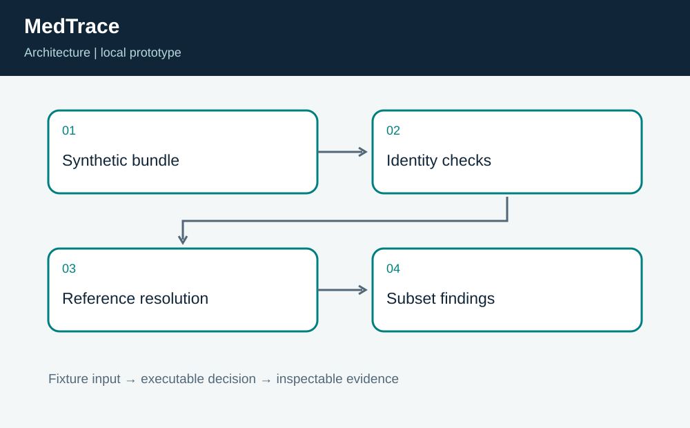
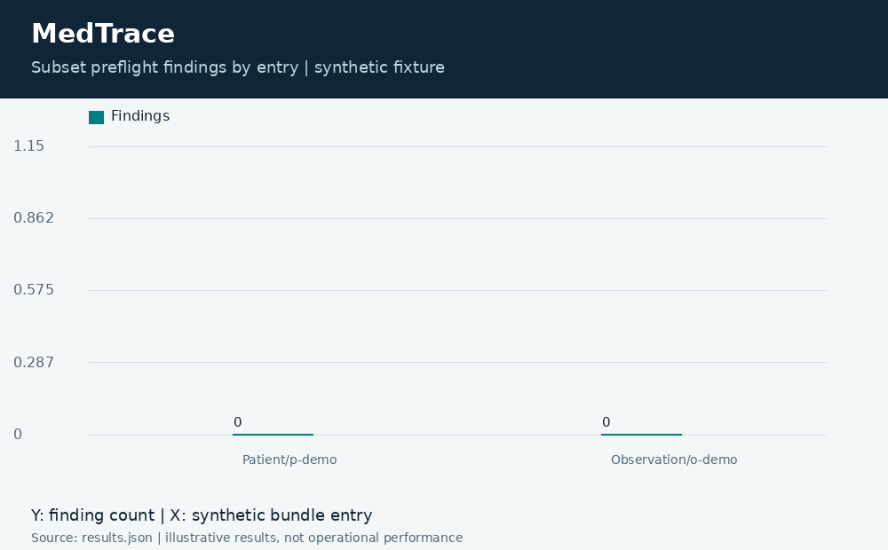
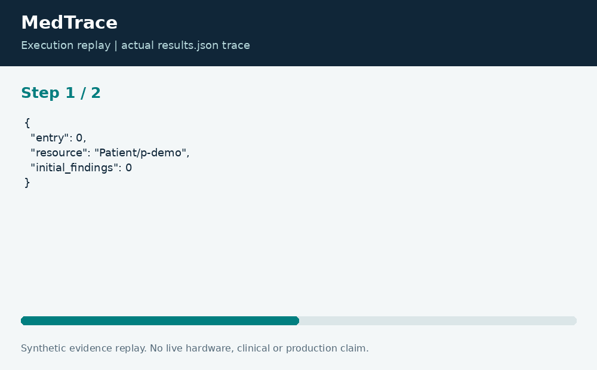

# MedTrace: Synthetic FHIR Bundle Preflight

**Neco Thomas · Project Phoenix · Independent portfolio prototype**  
Implementation and editorial preparation assisted by AI. All inputs are synthetic. Results below come from the included local execution; they are not employment accomplishments or production outcomes.

## The decision worth solving

Data that looks structurally familiar can still contain duplicate identities or broken references. An early pipeline check can make those failures easier to explain, provided it does not claim to replace the full interoperability standard.

**Engineering question:** Can a small preflight catch duplicate identities and unresolved references before a synthetic bundle enters a pipeline?

## What I am sharing

MedTrace supports a restricted FHIR R4 collection-bundle exercise with Patient and Observation resources. It checks local identity uniqueness, a simple fullUrl shape, an allowed Observation status, code presence, and subject-reference resolution within the bundle. Findings include the entry index and a stable code.



The project is self-contained: source, its own fixture, eight tests, a saved result, a technical diagram, a result chart, and an animated execution trace. It has no runtime dependency on the other nineteen projects. The common entry point is only a convenience for reviewers; the decision logic belongs to this project.

## Run the demonstration

Requirements: Python 3.12 or newer. The primary CLI uses only the Python standard library; native components require the named toolchain. No API keys, paid services, patient records, robot hardware, or cloud account are required.

```bash
python3 app.py
python3 -m unittest discover -s tests -v
```

On Windows use `python` or `py -3` if `python3` is not installed. Native C/C++ entry points currently expect the Linux GCC toolchain. Linux execution is verified; other operating systems are extension targets until separately tested. `run.ps1` and `run.sh` are convenience launchers, not evidence of OS certification.

## What the run actually showed

The synthetic two-entry fixture passes the subset and resolves one reference. Tests intentionally introduce duplicate fullUrls, duplicate resource identities, an unresolved subject, a missing status, and an unsupported resource type. A URN reference is also checked for successful local resolution.

| Metric | Fixture result |
| --- | ---: |
| entries | 2 |
| findings | 0 |
| resolved references | 1 |



The chart uses one stated measurement unit and is computed directly from the saved output. Exact values and the execution trace are in [results.json](results.json), and individual assertions are visible in [the test file](tests/test_project.py).



## The tradeoff and the boundary

This is not a full FHIR validator, server, terminology service, conformance statement, privacy control, or clinical-quality check. The simplified fullUrl and ID rules are narrower than the complete specification, and many required semantic constraints are outside scope. No real patient records are used.

The test evidence supports behavior on the published cases. It does not establish production reliability or a universal performance estimate. Invalid inputs are rejected or represented explicitly according to the implementation; a reviewer should read the tested boundary cases before extending the input contract.

## How a team would move this forward

Interoperability engineers should own profile selection and terminology bindings. Clinical informatics should review meaning; privacy and security teams should review real-data handling separately. The next milestone is a comparison against an official FHIR validator and a documented implementation guide before any real integration is considered.

For a principal-level review, the useful handoff is the decision contract: who supplies each input, who interprets exceptions, who approves any real-world action, and what evidence would justify expanding the scope. That handoff is separate from the prototype run and remains a proposed next step.

## Reproduce and review

Each folder can be copied out and run independently. `validation.log` records the eight local assertions. Optional chart regeneration uses Pillow: install `requirements-visuals.txt`, then run `python3 visualize.py`. The figures replay saved results and do not fabricate measurements. Re-run the CLI before redrawing figures after changing a fixture.

Primary technical reference: [https://hl7.org/fhir/R4/bundle.html](https://hl7.org/fhir/R4/bundle.html). This reference informs the implementation context; it does not endorse or certify this project.

[Source and project files](https://github.com/bigneek78/data-platform-reliability-lab/tree/main/frontier-projects/15-medtrace) · [All twenty projects](https://github.com/bigneek78/data-platform-reliability-lab/tree/main/frontier-projects)
