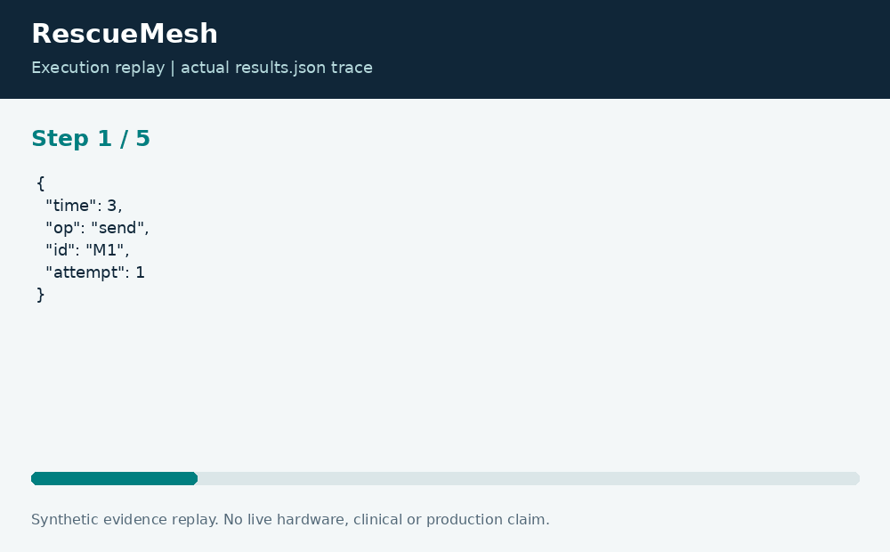

# RescueMesh: Offline Message Queue Simulation

**Neco Thomas · Project Phoenix · Independent portfolio prototype**  
Implementation and editorial preparation assisted by AI. All inputs are synthetic. Results below come from the included local execution; they are not employment accomplishments or production outcomes.

## The decision worth solving

Disconnected systems need to explain what happened to a message, not just keep retrying it. A sender may see a timeout after a receiver has already processed a request. A useful queue model distinguishes attempts, acknowledgements, expiration, and duplicate submission.

**Engineering question:** Can a disconnected field queue retry messages without duplicating acknowledged delivery?

## What I am sharing

RescueMesh runs a deterministic event stream in TypeScript. Pending messages can be sent on an online tick after a retry delay. Only an attempted pending message can be acknowledged. An absolute expiry is evaluated before every event, and a known message identity suppresses a later duplicate enqueue.


The project is self-contained: source, its own fixture, eight tests, a saved result, a technical diagram, a result chart, and an animated execution trace. It has no runtime dependency on the other nineteen projects. The common entry point is only a convenience for reviewers; the decision logic belongs to this project.

## Run the demonstration

Requirements: Python 3.12 or newer and Node.js 24 or newer. The primary CLI uses only the Python standard library; native components require the named toolchain. No API keys, paid services, patient records, robot hardware, or cloud account are required.

```bash
python3 app.py
python3 -m unittest discover -s tests -v
```

On Windows use `python` or `py -3` if `python3` is not installed. Native C/C++ entry points currently expect the Linux GCC toolchain. Linux execution is verified; other operating systems are extension targets until separately tested. `run.ps1` and `run.sh` are convenience launchers, not evidence of OS certification.

## What the run actually showed

The fixture records two send attempts, one acknowledged message, one expired message, and one duplicate enqueue. Tests cover offline ticks, exact expiry, retry spacing, and an acknowledgement for an unknown identity. The timeline makes each state change inspectable.

| Metric | Fixture result |
| --- | ---: |
| send attempts | 2 |
| acknowledged | 1 |
| expired | 1 |
| duplicate enqueues | 1 |


The chart uses one stated measurement unit and is computed directly from the saved output. Exact values and the execution trace are in [results.json](results.json), and individual assertions are visible in [the test file](tests/test_project.py).



## The tradeoff and the boundary

The simulation is in memory; it is not a durable delivery service or an emergency dispatch channel. Duplicate suppression is local to this process lifetime and does not prove exactly-once processing at a remote receiver. Payload authentication, encryption, disk recovery, and multi-device ordering remain unimplemented.

The test evidence supports behavior on the published cases. It does not establish production reliability or a universal performance estimate. Invalid inputs are rejected or represented explicitly according to the implementation; a reviewer should read the tested boundary cases before extending the input contract.

## How a team would move this forward

Field operations should define message lifetime and escalation. Distributed-systems engineers should design persistent inbox and outbox semantics, while security engineers define identities and trust. The next milestone is a crash-recovery test with a receiver-side idempotency ledger and controlled network-failure injection.

For a principal-level review, the useful handoff is the decision contract: who supplies each input, who interprets exceptions, who approves any real-world action, and what evidence would justify expanding the scope. That handoff is separate from the prototype run and remains a proposed next step.

## Reproduce and review

Each folder can be copied out and run independently. `validation.log` records the eight local assertions. Optional chart regeneration uses Pillow: install `requirements-visuals.txt`, then run `python3 visualize.py`. The figures replay saved results and do not fabricate measurements. Re-run the CLI before redrawing figures after changing a fixture.

Primary technical reference: [https://nodejs.org/api/typescript.html](https://nodejs.org/api/typescript.html). This reference informs the implementation context; it does not endorse or certify this project.

[Source and project files](https://github.com/bigneek78/data-platform-reliability-lab/tree/main/frontier-projects/16-rescuemesh) · [All twenty projects](https://github.com/bigneek78/data-platform-reliability-lab/tree/main/frontier-projects)
