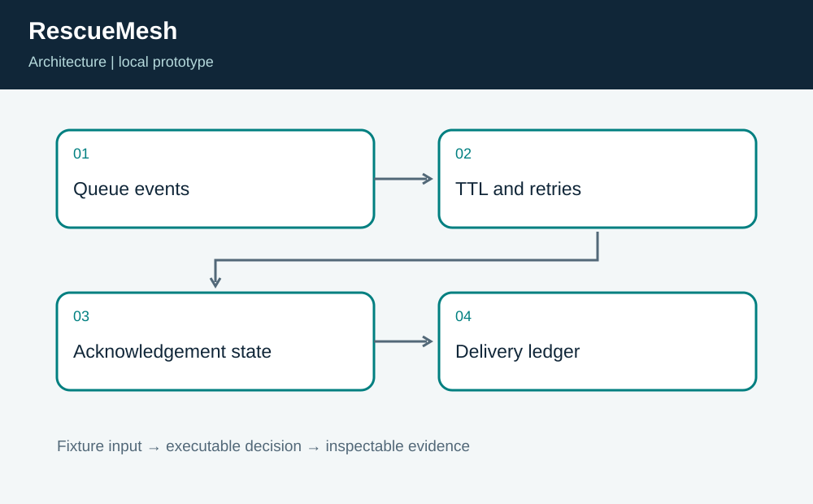
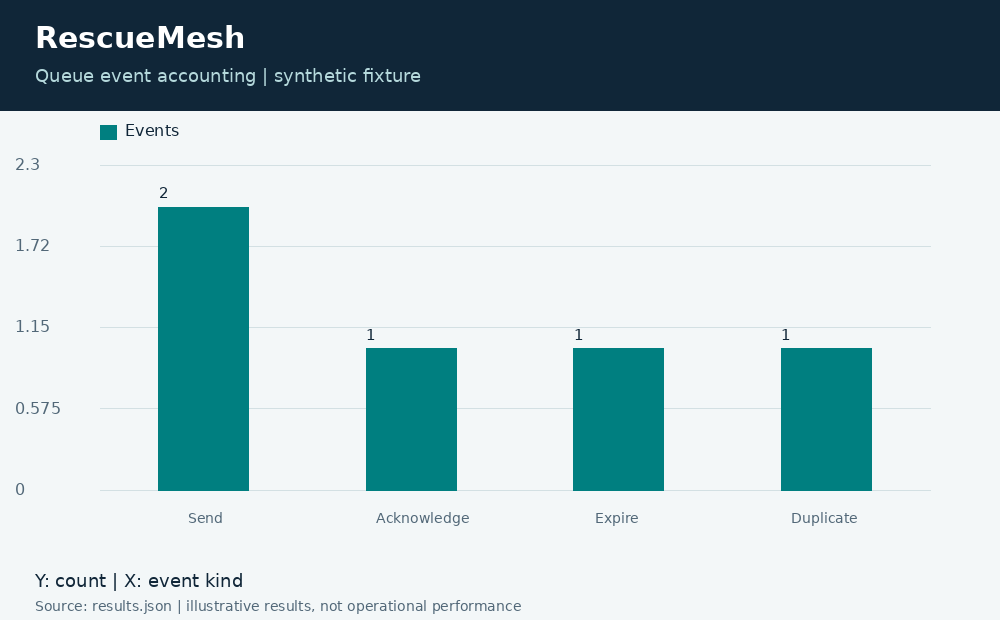

# RescueMesh: Offline Message Queue Simulation

**Independent project 16 of 20 · Resilient communications · TypeScript + Python**

Prepared for Neco Thomas with AI assistance. Synthetic portfolio prototype; no production, clinical, physical-hardware, or employer-delivery claim.

Can a disconnected field queue retry messages without duplicating acknowledged delivery?

**Method:** Deterministic event-driven queue with acknowledgements, retry delay, and absolute TTL expiry.

**Observed result:** The fixture records two send attempts, one acknowledged message, one expired message, and one duplicate enqueue. Tests cover offline ticks, exact expiry, retry spacing, and an acknowledgement for an unknown identity. The timeline makes each state change inspectable.



## Run this project on its own

Requirements: Python 3.12 or newer and Node.js 24 or newer. No other project folder is imported.

```bash
python3 app.py
python3 -m unittest discover -s tests -v
```

**Local validation: 8 tests passed.** The CLI and all required native components executed on Linux. See [validation.log](validation.log) and [results.json](results.json). Optional figures need Pillow; application/tests otherwise use standard-library Python plus the named native toolchain.

| Metric | Result |
| --- | ---: |
| send attempts | 2 |
| acknowledged | 1 |
| expired | 1 |
| duplicate enqueues | 1 |



## Engineering boundary

The simulation is in memory; it is not a durable delivery service or an emergency dispatch channel. Duplicate suppression is local to this process lifetime and does not prove exactly-once processing at a remote receiver. Payload authentication, encryption, disk recovery, and multi-device ordering remain unimplemented.

## Team handoff

Field operations should define message lifetime and escalation. Distributed-systems engineers should design persistent inbox and outbox semantics, while security engineers define identities and trust. The next milestone is a crash-recovery test with a receiver-side idempotency ledger and controlled network-failure injection.

Read the [complete article](ARTICLE.md), inspect the [tests](tests/test_project.py), or view the [animated result trace](assets/replay.gif). The [manifest](project.json) identifies this standalone project. Configurations for CI and containers are supplied as configurations; their status is tracked separately from local execution.

Primary reference: https://nodejs.org/api/typescript.html
