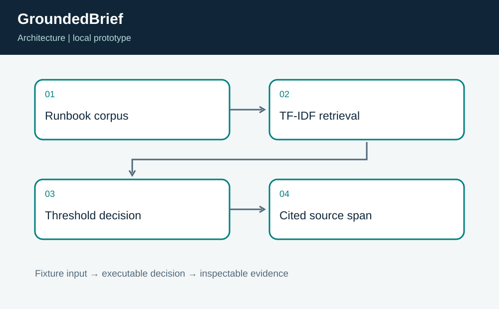
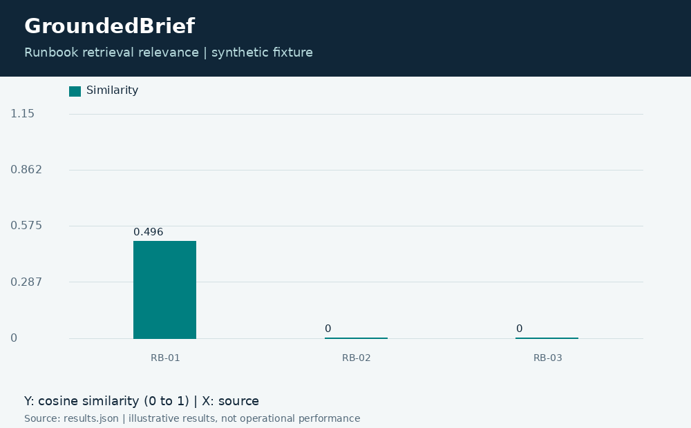
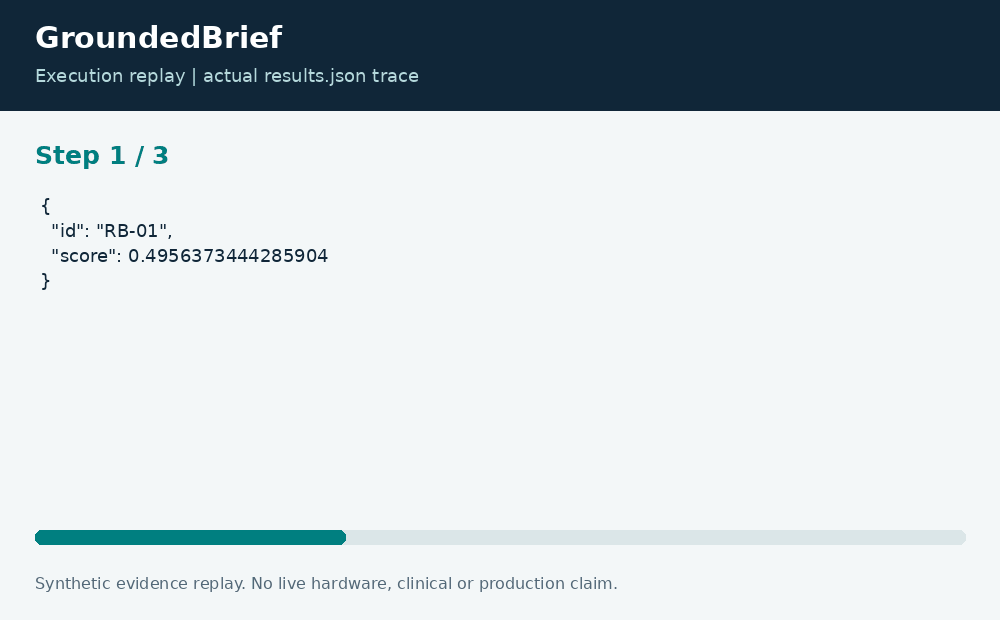

# GroundedBrief: Retrieval With Evidence and Abstention

**Neco Thomas · Project Phoenix · Independent portfolio prototype**  
Implementation and editorial preparation assisted by AI. All inputs are synthetic. Results below come from the included local execution; they are not employment accomplishments or production outcomes.

## The decision worth solving

A polished support answer is less useful than a traceable passage when the evidence is thin. GroundedBrief starts with retrieval and abstention because those behaviors can be tested without claiming that a language model understands a system.

**Engineering question:** Can a support assistant retrieve a relevant passage and refuse a query with insufficient evidence?

## What I am sharing

The prototype tokenizes three original synthetic runbook passages, builds local TF-IDF vectors, and ranks cosine similarity to the query. If the top score fails the threshold, it abstains. Otherwise, it extracts an original sentence with overlapping query terms and returns its source identifier.



The project is self-contained: source, its own fixture, eight tests, a saved result, a technical diagram, a result chart, and an animated execution trace. It has no runtime dependency on the other nineteen projects. The common entry point is only a convenience for reviewers; the decision logic belongs to this project.

## Run the demonstration

Requirements: Python 3.12 or newer. The primary CLI uses only the Python standard library; native components require the named toolchain. No API keys, paid services, patient records, robot hardware, or cloud account are required.

```bash
python3 app.py
python3 -m unittest discover -s tests -v
```

On Windows use `python` or `py -3` if `python3` is not installed. Native C/C++ entry points currently expect the Linux GCC toolchain. Linux execution is verified; other operating systems are extension targets until separately tested. `run.ps1` and `run.sh` are convenience launchers, not evidence of OS certification.

## What the run actually showed

The restore-drill question selects RB-01 with a top similarity of approximately 0.496. The quoted answer is asserted to be an exact span of the selected source. An unrelated geology query and an empty query both abstain. No generative model or remote model API is called.

| Metric | Fixture result |
| --- | ---: |
| top similarity | 0.495637 |
| documents scored | 3 |
| evidence passages | 1 |



The chart uses one stated measurement unit and is computed directly from the saved output. Exact values and the execution trace are in [results.json](results.json), and individual assertions are visible in [the test file](tests/test_project.py).



## The tradeoff and the boundary

Lexical relevance is not a guarantee of factual support or completeness. The threshold is illustrative, the corpus is tiny, and synonymous wording can be missed. A passage containing misleading content would still require source governance; the implementation is not a prompt-injection defense or a semantic entailment engine.

The test evidence supports behavior on the published cases. It does not establish production reliability or a universal performance estimate. Invalid inputs are rejected or represented explicitly according to the implementation; a reviewer should read the tested boundary cases before extending the input contract.

## How a team would move this forward

Support specialists should own runbook accuracy and permissions. AI engineers should build a separately labeled answerability benchmark; security should review retrieval boundaries. The next milestone is a blinded evaluation of source selection, refusal behavior, and answer coverage before introducing any generation stage.

For a principal-level review, the useful handoff is the decision contract: who supplies each input, who interprets exceptions, who approves any real-world action, and what evidence would justify expanding the scope. That handoff is separate from the prototype run and remains a proposed next step.

## Reproduce and review

Each folder can be copied out and run independently. `validation.log` records the eight local assertions. Optional chart regeneration uses Pillow: install `requirements-visuals.txt`, then run `python3 visualize.py`. The figures replay saved results and do not fabricate measurements. Re-run the CLI before redrawing figures after changing a fixture.

Primary technical reference: [https://docs.python.org/3/library/collections.html](https://docs.python.org/3/library/collections.html). This reference informs the implementation context; it does not endorse or certify this project.

[Source and project files](https://github.com/bigneek78/data-platform-reliability-lab/tree/main/frontier-projects/17-groundedbrief) · [All twenty projects](https://github.com/bigneek78/data-platform-reliability-lab/tree/main/frontier-projects)
