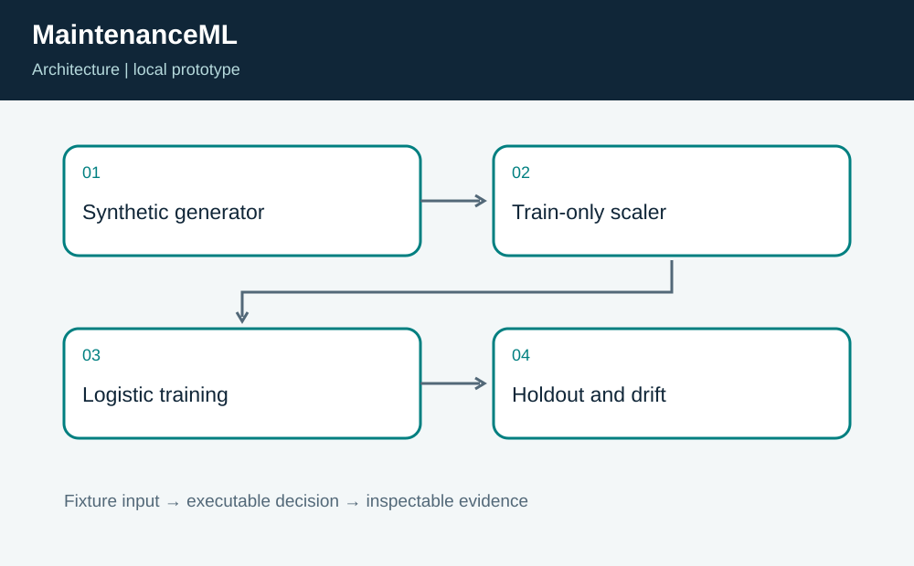
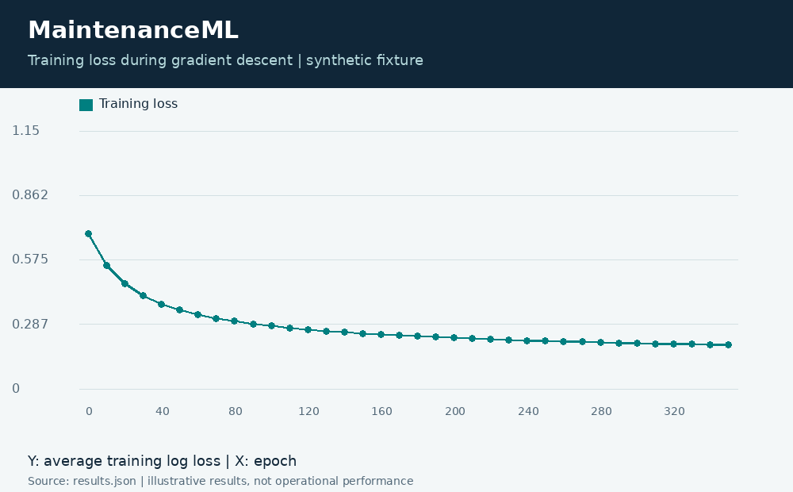
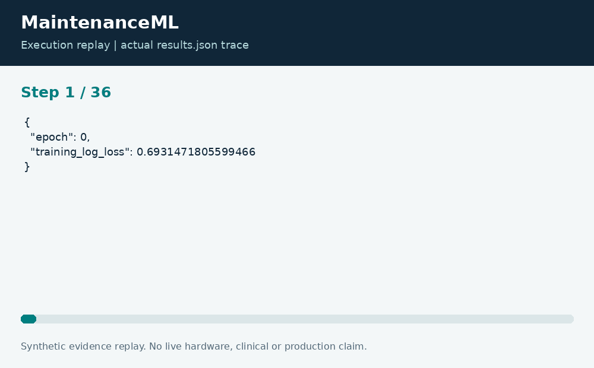

# MaintenanceML: Synthetic Failure Classifier and Drift Review

**Neco Thomas · Project Phoenix · Independent portfolio prototype**  
Implementation and editorial preparation assisted by AI. All inputs are synthetic. Results below come from the included local execution; they are not employment accomplishments or production outcomes.

## The decision worth solving

Model performance is difficult to assess when training and evaluation are mixed together. MaintenanceML makes the split, normalization, learning curve, and confusion matrix visible so a reviewer can inspect how a reported score was produced.

**Engineering question:** Can a small classifier show its holdout results and reveal a shifted operating population?

## What I am sharing

A seeded generator creates fictional temperature, vibration, and failure-label rows. The program shuffles and splits the data, fits standardization only on training rows, then trains logistic regression with full-batch gradient descent. A separate holdout is evaluated once by the execution path. A shifted copy of the holdout demonstrates standardized-mean drift review.



The project is self-contained: source, its own fixture, eight tests, a saved result, a technical diagram, a result chart, and an animated execution trace. It has no runtime dependency on the other nineteen projects. The common entry point is only a convenience for reviewers; the decision logic belongs to this project.

## Run the demonstration

Requirements: Python 3.12 or newer. The primary CLI uses only the Python standard library; native components require the named toolchain. No API keys, paid services, patient records, robot hardware, or cloud account are required.

```bash
python3 app.py
python3 -m unittest discover -s tests -v
```

On Windows use `python` or `py -3` if `python3` is not installed. Native C/C++ entry points currently expect the Linux GCC toolchain. Linux execution is verified; other operating systems are extension targets until separately tested. `run.ps1` and `run.sh` are convenience launchers, not evidence of OS certification.

## What the run actually showed

The fixture uses 240 training rows and 80 holdout rows, with 0.9875 holdout accuracy on this generated problem. Training log loss falls from about 0.693 to 0.196. The synthetic population shift triggers a review flag. Tests verify deterministic reproduction, scaling arithmetic, split accounting, and loss reduction.

| Metric | Fixture result |
| --- | ---: |
| holdout accuracy | 0.9875 |
| holdout rows | 80 |
| training rows | 240 |
| initial log loss | 0.693147 |
| final log loss | 0.195524 |



The chart uses one stated measurement unit and is computed directly from the saved output. Exact values and the execution trace are in [results.json](results.json), and individual assertions are visible in [the test file](tests/test_project.py).



## The tradeoff and the boundary

The labels were generated from the same simple feature relationship the classifier can learn. The score therefore demonstrates implementation behavior, not effectiveness at predicting real failures. There is no external validation set, real maintenance label review, calibration study, or deployment claim.

The test evidence supports behavior on the published cases. It does not establish production reliability or a universal performance estimate. Invalid inputs are rejected or represented explicitly according to the implementation; a reviewer should read the tested boundary cases before extending the input contract.

## How a team would move this forward

Reliability engineers should define failure labels and intervention costs. Data scientists should examine temporal leakage, class balance, calibration, and external validation. The next milestone is a time-separated evaluation on appropriately governed equipment data with a documented model card and a human maintenance decision process.

For a principal-level review, the useful handoff is the decision contract: who supplies each input, who interprets exceptions, who approves any real-world action, and what evidence would justify expanding the scope. That handoff is separate from the prototype run and remains a proposed next step.

## Reproduce and review

Each folder can be copied out and run independently. `validation.log` records the eight local assertions. Optional chart regeneration uses Pillow: install `requirements-visuals.txt`, then run `python3 visualize.py`. The figures replay saved results and do not fabricate measurements. Re-run the CLI before redrawing figures after changing a fixture.

Primary technical reference: [https://docs.python.org/3/library/random.html](https://docs.python.org/3/library/random.html). This reference informs the implementation context; it does not endorse or certify this project.

[Source and project files](https://github.com/bigneek78/data-platform-reliability-lab/tree/main/frontier-projects/18-maintenance-ml) · [All twenty projects](https://github.com/bigneek78/data-platform-reliability-lab/tree/main/frontier-projects)
