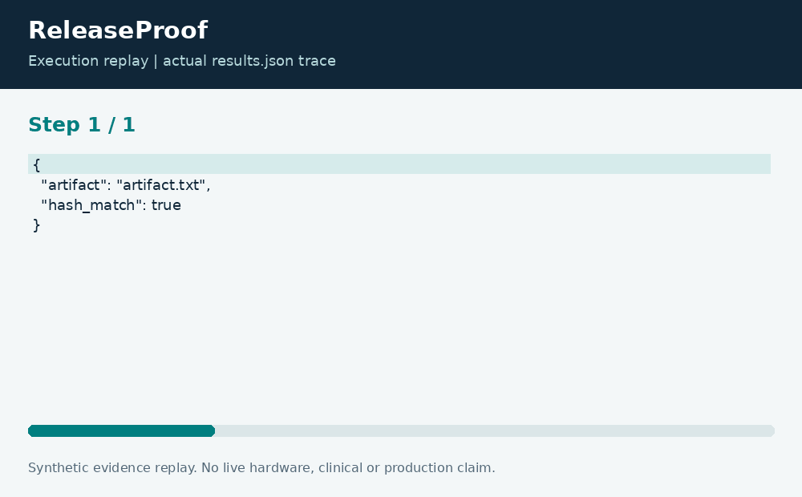

# ReleaseProof: Artifact and Test Evidence Gate

**Neco Thomas · Project Phoenix · Independent portfolio prototype**  
Implementation and editorial preparation assisted by AI. All inputs are synthetic. Results below come from the included local execution; they are not employment accomplishments or production outcomes.

## The decision worth solving

A successful build badge does not establish that a particular artifact matches a particular test record. A release review needs bindings between the file bytes, the expected commit, and the evidence being offered. ReleaseProof makes a small part of that chain executable.

**Engineering question:** Should an illustrative release proceed when artifact digests and test records disagree?

## What I am sharing

A TypeScript gate hashes local manifest files with SHA-256 and compares them with declared digests. It rejects paths that leave a bounded fixture directory, nonfiles, and direct symlinks. Test evidence must have positive consistent counts, zero failures, a matching commit, and an acceptable age relative to an explicit fixture clock.


The project is self-contained: source, its own fixture, eight tests, a saved result, a technical diagram, a result chart, and an animated execution trace. It has no runtime dependency on the other nineteen projects. The common entry point is only a convenience for reviewers; the decision logic belongs to this project.

## Run the demonstration

Requirements: Python 3.12 or newer and Node.js 24 or newer. The primary CLI uses only the Python standard library; native components require the named toolchain. No API keys, paid services, patient records, robot hardware, or cloud account are required.

```bash
python3 app.py
python3 -m unittest discover -s tests -v
```

On Windows use `python` or `py -3` if `python3` is not installed. Native C/C++ entry points currently expect the Linux GCC toolchain. Linux execution is verified; other operating systems are extension targets until separately tested. `run.ps1` and `run.sh` are convenience launchers, not evidence of OS certification.

## What the run actually showed

The valid fixture verifies one artifact with zero findings. Eight tests exercise the positive path and failures involving hash mismatch, missing files, traversal, inconsistent counts, commit mismatch, stale or future evidence, and zero-test records. These are local checks of a synthetic record.

| Metric | Fixture result |
| --- | ---: |
| checked artifacts | 1 |
| findings | 0 |
| claimed tests | 8 |


The chart uses one stated measurement unit and is computed directly from the saved output. Exact values and the execution trace are in [results.json](results.json), and individual assertions are visible in [the test file](tests/test_project.py).



## The tradeoff and the boundary

A matching digest does not establish a trusted builder or signer. The record is unsigned and can be forged by anyone able to edit the fixture. The example commit string is an identifier, not a verified Git object. This is not a SLSA conformance claim or a complete provenance verifier.

The test evidence supports behavior on the published cases. It does not establish production reliability or a universal performance estimate. Invalid inputs are rejected or represented explicitly according to the implementation; a reviewer should read the tested boundary cases before extending the input contract.

## How a team would move this forward

Release engineering should define required attestations. Security should own trust roots and signer policy, while service owners define rollback and evidence retention. The next milestone is verification of signed provenance from an approved builder and binding to the actual artifact digest and source revision.

For a principal-level review, the useful handoff is the decision contract: who supplies each input, who interprets exceptions, who approves any real-world action, and what evidence would justify expanding the scope. That handoff is separate from the prototype run and remains a proposed next step.

## Reproduce and review

Each folder can be copied out and run independently. `validation.log` records the eight local assertions. Optional chart regeneration uses Pillow: install `requirements-visuals.txt`, then run `python3 visualize.py`. The figures replay saved results and do not fabricate measurements. Re-run the CLI before redrawing figures after changing a fixture.

Primary technical reference: [https://nodejs.org/api/crypto.html](https://nodejs.org/api/crypto.html). This reference informs the implementation context; it does not endorse or certify this project.

[Source and project files](https://github.com/bigneek78/data-platform-reliability-lab/tree/main/frontier-projects/19-releaseproof) · [All twenty projects](https://github.com/bigneek78/data-platform-reliability-lab/tree/main/frontier-projects)
