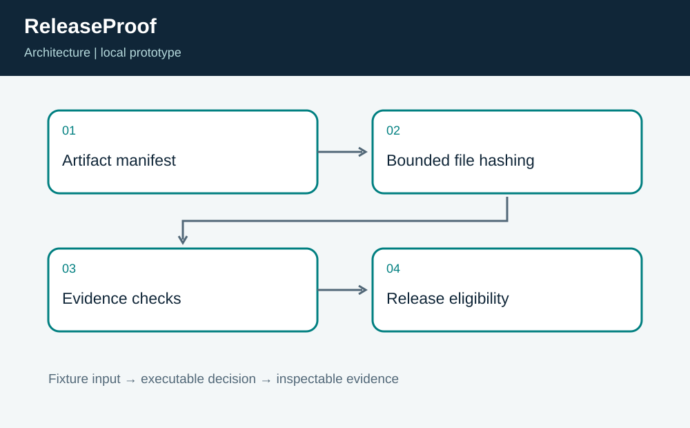
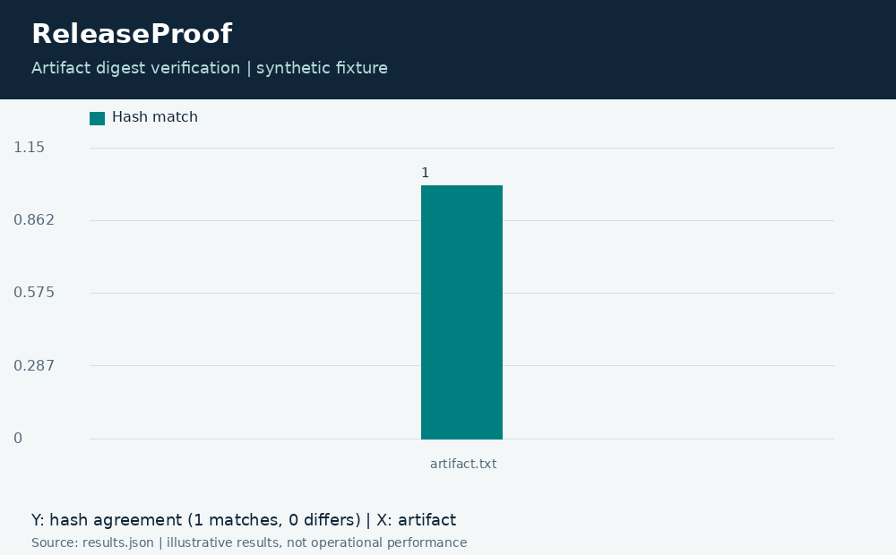

# ReleaseProof: Artifact and Test Evidence Gate

**Independent project 19 of 20 · Software supply chain · TypeScript + Python**

Prepared for Neco Thomas with AI assistance. Synthetic portfolio prototype; no production, clinical, physical-hardware, or employer-delivery claim.

Should an illustrative release proceed when artifact digests and test records disagree?

**Method:** SHA-256 verification, bounded local paths, commit binding, evidence age checks, and fail-closed test accounting.

**Observed result:** The valid fixture verifies one artifact with zero findings. Eight tests exercise the positive path and failures involving hash mismatch, missing files, traversal, inconsistent counts, commit mismatch, stale or future evidence, and zero-test records. These are local checks of a synthetic record.



## Run this project on its own

Requirements: Python 3.12 or newer and Node.js 24 or newer. No other project folder is imported.

```bash
python3 app.py
python3 -m unittest discover -s tests -v
```

**Local validation: 8 tests passed.** The CLI and all required native components executed on Linux. See [validation.log](validation.log) and [results.json](results.json). Optional figures need Pillow; application/tests otherwise use standard-library Python plus the named native toolchain.

| Metric | Result |
| --- | ---: |
| checked artifacts | 1 |
| findings | 0 |
| claimed tests | 8 |



## Engineering boundary

A matching digest does not establish a trusted builder or signer. The record is unsigned and can be forged by anyone able to edit the fixture. The example commit string is an identifier, not a verified Git object. This is not a SLSA conformance claim or a complete provenance verifier.

## Team handoff

Release engineering should define required attestations. Security should own trust roots and signer policy, while service owners define rollback and evidence retention. The next milestone is verification of signed provenance from an approved builder and binding to the actual artifact digest and source revision.

Read the [complete article](ARTICLE.md), inspect the [tests](tests/test_project.py), or view the [animated result trace](assets/replay.gif). The [manifest](project.json) identifies this standalone project. Configurations for CI and containers are supplied as configurations; their status is tracked separately from local execution.

Primary reference: https://nodejs.org/api/crypto.html
