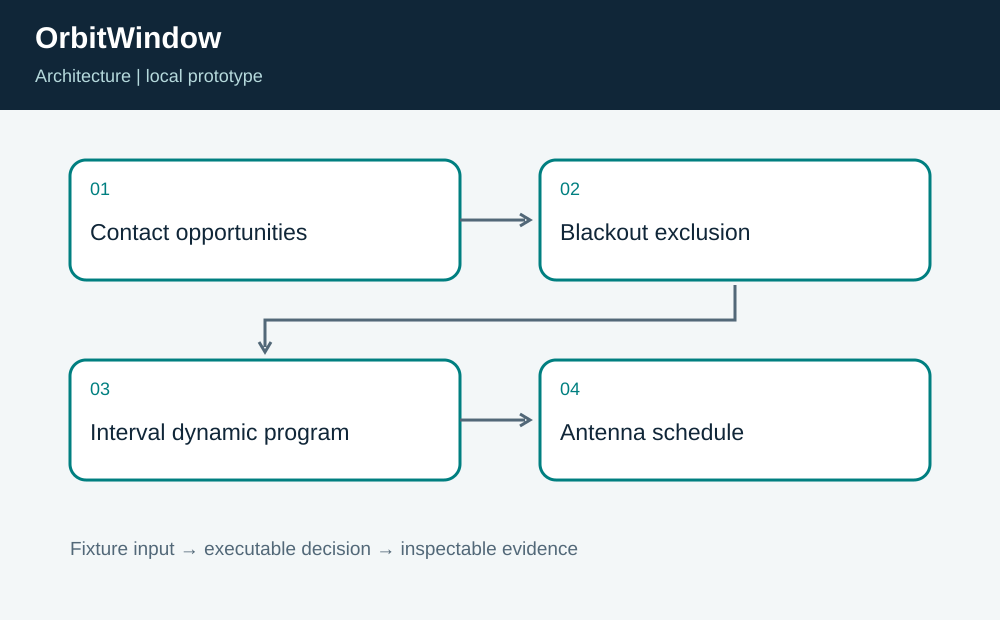
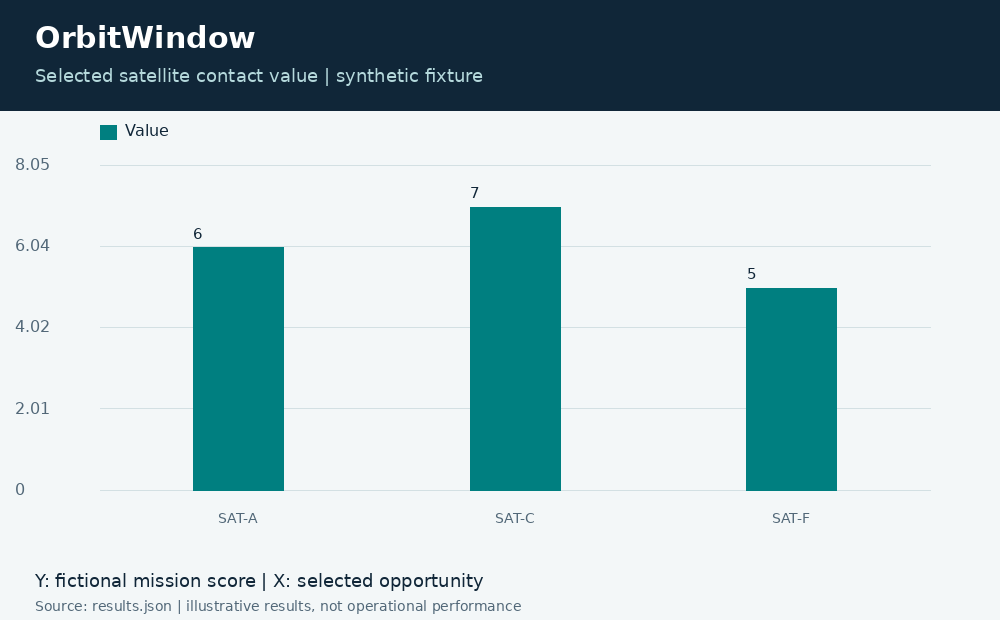
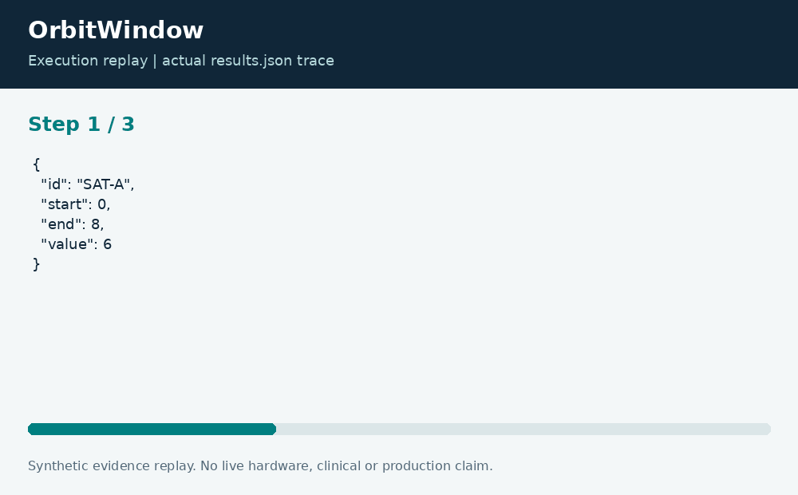

# OrbitWindow: Synthetic Ground-Station Scheduling

**Neco Thomas · Project Phoenix · Independent portfolio prototype**  
Implementation and editorial preparation assisted by AI. All inputs are synthetic. Results below come from the included local execution; they are not employment accomplishments or production outcomes.

## The decision worth solving

A ground-station antenna cannot serve overlapping contacts, and a maintenance blackout can invalidate an otherwise valuable opportunity. OrbitWindow isolates that scheduling decision from orbit prediction so the optimization can be reviewed with small known examples.

**Engineering question:** Which nonoverlapping synthetic contact opportunities maximize mission value around antenna blackouts?

## What I am sharing

The prototype removes fictional opportunities that intersect blackouts, sorts the remaining windows by end time, and computes a maximum-value nonoverlapping set with dynamic programming. Half-open intervals allow one contact to begin exactly when another ends. The result preserves selected windows and blackout exclusions.



The project is self-contained: source, its own fixture, eight tests, a saved result, a technical diagram, a result chart, and an animated execution trace. It has no runtime dependency on the other nineteen projects. The common entry point is only a convenience for reviewers; the decision logic belongs to this project.

## Run the demonstration

Requirements: Python 3.12 or newer. The primary CLI uses only the Python standard library; native components require the named toolchain. No API keys, paid services, patient records, robot hardware, or cloud account are required.

```bash
python3 app.py
python3 -m unittest discover -s tests -v
```

On Windows use `python` or `py -3` if `python3` is not installed. Native C/C++ entry points currently expect the Linux GCC toolchain. Linux execution is verified; other operating systems are extension targets until separately tested. `run.ps1` and `run.sh` are convenience launchers, not evidence of OS certification.

## What the run actually showed

The demonstration selects SAT-A, SAT-C, and SAT-F for a total value of 18 across 19 scheduled minutes. Two opportunities are excluded by blackout overlap. An independent exhaustive subset test confirms the optimal value for the fixture, while boundary tests check a contact ending exactly at a blackout start.

| Metric | Fixture result |
| --- | ---: |
| total value | 18 |
| selected contacts | 3 |
| selected minutes | 19 |
| blackout excluded | 2 |



The chart uses one stated measurement unit and is computed directly from the saved output. Exact values and the execution trace are in [results.json](results.json), and individual assertions are visible in [the test file](tests/test_project.py).



## The tradeoff and the boundary

The input windows are invented. The code performs no orbit propagation, antenna pointing, link-budget calculation, Doppler prediction, spectrum coordination, or live spacecraft control. Value is a user-defined score rather than a guaranteed mission outcome.

The test evidence supports behavior on the published cases. It does not establish production reliability or a universal performance estimate. Invalid inputs are rejected or represented explicitly according to the implementation; a reviewer should read the tested boundary cases before extending the input contract.

## How a team would move this forward

Mission planning should define priority and continuity requirements. RF and ground-system engineers should validate contact feasibility, while operations should own maintenance windows. The next milestone is an independently validated opportunity generator and multi-antenna scheduling model, with all command authority kept outside this prototype.

For a principal-level review, the useful handoff is the decision contract: who supplies each input, who interprets exceptions, who approves any real-world action, and what evidence would justify expanding the scope. That handoff is separate from the prototype run and remains a proposed next step.

## Reproduce and review

Each folder can be copied out and run independently. `validation.log` records the eight local assertions. Optional chart regeneration uses Pillow: install `requirements-visuals.txt`, then run `python3 visualize.py`. The figures replay saved results and do not fabricate measurements. Re-run the CLI before redrawing figures after changing a fixture.

Primary technical reference: [https://docs.python.org/3/library/bisect.html](https://docs.python.org/3/library/bisect.html). This reference informs the implementation context; it does not endorse or certify this project.

[Source and project files](https://github.com/bigneek78/data-platform-reliability-lab/tree/main/frontier-projects/20-orbitwindow) · [All twenty projects](https://github.com/bigneek78/data-platform-reliability-lab/tree/main/frontier-projects)
