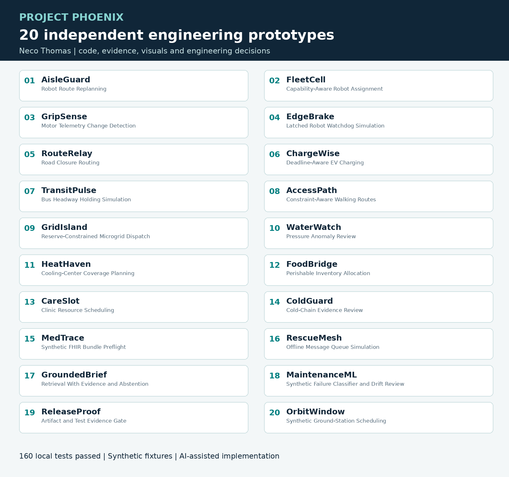

# Project Phoenix: Twenty Independent Engineering Projects

**Neco Thomas · Principal-level engineering decisions, demonstrated through small executable prototypes.**



Twenty separate projects, each with its own problem, executable source, fixture, eight tests, results, article, diagram, chart, and animation. Each folder runs independently and can be extracted into a separate repository. They are new work alongside the earlier fifteen Phoenix samples, not a renaming of those samples.

**Verified locally: 20 demos, 160 tests, Linux, Python 3.12, Node.js 24, C11, C++17, Java 17, and SQLite.**

All inputs are synthetic. Code and editorial preparation were assisted by AI. These are independent portfolio prototypes, not claims of employer delivery, physical robot construction, real patient use, clinical validation, flight qualification, or production deployment.

| # | Separate project | Domain | Executed language or engine | Tests |
| --- | --- | --- | --- | ---: |
| 01 | [AisleGuard](01-aisleguard) | Robotics | C++17 + Python | 8 / 8 |
| 02 | [FleetCell](02-fleetcell) | Robotics | Python | 8 / 8 |
| 03 | [GripSense](03-gripsense) | Robotics | Python | 8 / 8 |
| 04 | [EdgeBrake](04-edgebrake) | Robotics | C11 + Python | 8 / 8 |
| 05 | [RouteRelay](05-routerelay) | Transportation | JavaScript + Python | 8 / 8 |
| 06 | [ChargeWise](06-chargewise) | Transportation and energy | Python | 8 / 8 |
| 07 | [TransitPulse](07-transitpulse) | Transportation | Java 17 + Python | 8 / 8 |
| 08 | [AccessPath](08-accesspath) | Accessible transportation | Python | 8 / 8 |
| 09 | [GridIsland](09-gridisland) | Energy | Python | 8 / 8 |
| 10 | [WaterWatch](10-waterwatch) | Water infrastructure | Python | 8 / 8 |
| 11 | [HeatHaven](11-heathaven) | Community infrastructure | Python | 8 / 8 |
| 12 | [FoodBridge](12-foodbridge) | Food systems | SQL + Python | 8 / 8 |
| 13 | [CareSlot](13-careslot) | Healthcare operations | Python | 8 / 8 |
| 14 | [ColdGuard](14-coldguard) | Healthcare logistics | Python + XML | 8 / 8 |
| 15 | [MedTrace](15-medtrace) | Healthcare data engineering | Python + JSON | 8 / 8 |
| 16 | [RescueMesh](16-rescuemesh) | Resilient communications | TypeScript + Python | 8 / 8 |
| 17 | [GroundedBrief](17-groundedbrief) | AI systems | Python | 8 / 8 |
| 18 | [MaintenanceML](18-maintenance-ml) | Machine learning | Python | 8 / 8 |
| 19 | [ReleaseProof](19-releaseproof) | Software supply chain | TypeScript + Python | 8 / 8 |
| 20 | [OrbitWindow](20-orbitwindow) | Space systems planning | Python | 8 / 8 |

## Run one project

Open its folder, read its requirements, and run:

```bash
python3 app.py
python3 -m unittest discover -s tests -v
```

There are no shared application imports. Python tests require no third-party Python package. Native projects need their stated compiler/runtime. Figures can be rebuilt separately with Pillow.

## Review the evidence

- [Execution record](execution-record.json): individual process exit codes and elapsed times.
- [Technology coverage](TECHNOLOGY_COVERAGE.md): executed technologies versus supplied configurations and extension targets.
- [Validation and limitations](VALIDATION.md): the test scope and what it does not establish.
- Each project: `README.md`, `ARTICLE.md`, `ARTICLE.html`, `app.py`, `tests/`, `fixtures/`, `results.json`, `validation.log`, `assets/`, and a project-specific LinkedIn post draft.

The collection index is only navigation. It is not a replacement for twenty separately runnable projects. Medium and GitLab publishing status is tracked in the delivery report; prepared article files should not be mistaken for live Medium posts.
