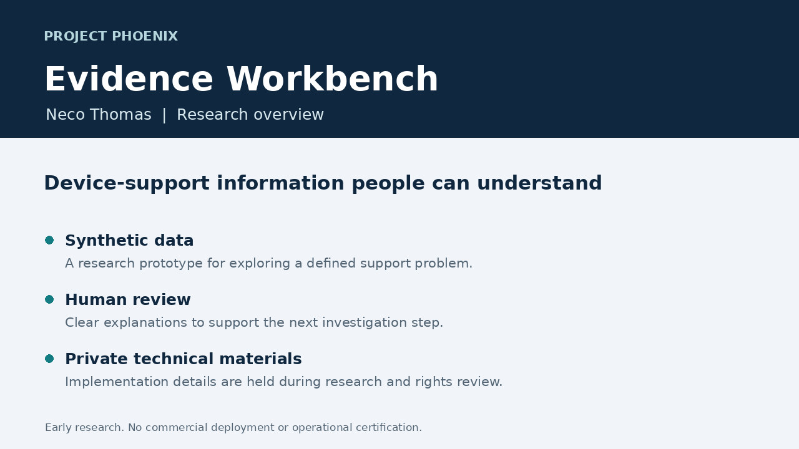

# Project Phoenix Evidence Workbench

Public research overview by Neco Thomas.

I am developing a research prototype to make device-support information easier to understand. The current work uses synthetic data and focuses on clear explanations for a human reviewer.

The practical question is how a support team can understand the available evidence and decide what to check next. The project is at the research stage, with no commercial deployment or operational certification to announce.

The next milestone is to validate a narrow use case with appropriate specialists and independently collected evidence. Technical materials remain private while I evaluate ownership options and customer needs.

This page is a nontechnical project overview. It does not distribute the implementation, trained model, detailed design or technical learning materials. It makes no claim of worldwide novelty, patent protection or exclusive market rights.
